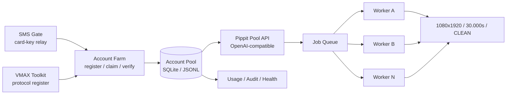

# AI Pool Automation Suite

> 一套围绕 AI 账号池、视频批量生成、短信接码与批量注册的自动化工具集。
> OpenAI-style video API · Seedance 2.5 farm · SMS gate · VMAX bulk register · Doubao video kit

[](https://www.python.org/)
[](https://fastapi.tiangolo.com/)
[](LICENSE)
[]()

---

## 1. 这是什么

`ai-pool-automation-suite` 把几套独立但互补的自动化能力放在同一个仓库里：

- **Pippit Pool API**：把账号池封装成 OpenAI 风格视频生成 API，支持多 Key、配额、排队、账号调度、失败换号与无水印成片。
- **Pippit Pool Control**：公网控制面 + 远程 worker 的部署形态，带 TOTP 后台、任务租约和 worker 回传。
- **Seedance 2.5 Farm**：账号注册、积分领取、号池健康检查、量产线调度与成片质检。
- **SMS Gate**：卡密制短信验证码接收与分发中台，支持多号源、号码池、直链卡和 TOTP 后台。
- **VMAX Bulk Register**：协议级批量注册/登录工具链，含滑块 token 农场、实卡 Modem 收码、限流节流和产能规划。
- **Doubao Video Kit**：豆包免费视频额度的脚本化 CLI。
- **Lark Bulk Register**：飞书协议注册与企业创建工具（历史项目，协议参考）。

> 所有代码仅用于自有账号、已授权账号或合规测试环境。请自行确认目标平台服务条款与当地法律。

---

## 2. 架构



### 数据流

1. 账号农场完成注册、领积分与验分，写入账号池。
2. Pool API 按积分、冷却、并发和 Key 配额选择账号。
3. Worker 提交生成任务，轮询进度，下载成片并做质量门校验。
4. 失败任务按错误类型换号或重排；成功后回传视频与元数据。
5. SMS Gate / VMAX 只负责注册链路的接码与账号生产，不接触成片。

---

## 3. 项目矩阵

| 目录 | 项目 | 核心能力 | 技术栈 |
|---|---|---|---|
| [`apps/pippit-pool-api`](apps/pippit-pool-api/) | Pippit 号池视频 API | OpenAI 风格 `/v1/videos`、Key 配额、任务队列、账号调度、无水印下载 | FastAPI / SQLite / requests |
| [`apps/pippit-pool-control`](apps/pippit-pool-control/) | Pippit 控制面 | 公网控制面、远程 worker、TOTP 后台、任务租约、结果回传 | FastAPI / SQLite / TOTP |
| [`apps/seedance-farm`](apps/seedance-farm/) | Seedance 2.5 农场 | 注册、领分、验分、量产线、收割、看护 | Python / Playwright / psutil |
| [`apps/sms-gate`](apps/sms-gate/) | 卡密短信中台 | 授权卡、直链卡、5 号段、号码池、限流审计 | FastAPI / SQLite / Jinja2 |
| [`apps/vmax-bulk-register`](apps/vmax-bulk-register/) | VMAX 协议注册 | 滑块 token、Modem 收码、批量调度、产能规划 | Python / Playwright / pyserial |
| [`apps/doubao-video-kit`](apps/doubao-video-kit/) | 豆包视频工具包 | 额度查询、直链、下载、去水印、提交生成 | Python / requests |
| [`apps/lark-bulk-register`](apps/lark-bulk-register/) | 飞书批量注册 | 协议注册、企业创建、ADB UI 兜底 | Python / Frida / ADB |

---

## 4. 快速开始

### 4.1 Pippit Pool API

```bash
cd apps/pippit-pool-api
python -m venv .venv
source .venv/bin/activate        # Windows: .venv\Scripts\activate
pip install -r requirements.txt

export WZ_HOST=127.0.0.1
export WZ_PORT=8788
export WZ_ADMIN_TOKEN='<CHANGE_ME>'
python app.py
```

创建 Key：

```bash
curl -X POST http://127.0.0.1:8788/admin/keys \
  -H "X-Admin-Token: <CHANGE_ME>" \
  -H "Content-Type: application/json" \
  -d '{"name":"demo","quota":240}'
```

提交 30 秒任务：

```bash
curl -X POST http://127.0.0.1:8788/v1/videos \
  -H "Authorization: Bearer sk-pp-REPLACE_ME" \
  -H "Content-Type: application/json" \
  -d '{"model":"pippit-smart-1080p-30s","prompt":"Vertical 9:16 30-second product film, no text, no logos.","seconds":30,"size":"1080x1920"}'
```

### 4.2 Pippit Pool Control

```bash
cd apps/pippit-pool-control
pip install fastapi uvicorn requests
export API_ADMIN_TOKEN='<CHANGE_ME>'
python run_api.py
```

远程 worker：

```bash
export API_BASE='http://127.0.0.1:8787'
export API_ADMIN_TOKEN='<CHANGE_ME>'
python worker_remote.py
```

### 4.3 SMS Gate

```bash
cd apps/sms-gate
python -m venv .venv
source .venv/bin/activate
pip install -r requirements.txt
mkdir -p data logs
uvicorn app.main:app --host 127.0.0.1 --port 8861
```

首次启动后读取 `data/setup.token`，打开：

```text
http://127.0.0.1:8861/admin/setup?t=<setup-token>
```

### 4.4 Seedance Farm

```bash
cd apps/seedance-farm
pip install -r requirements.txt
export PP_HOME="$PWD"
export PP_PORTS='127.0.0.1:21030'
export PP_INVITE_CODE='<INVITE_CODE>'
python _r329_farm_us.py 1 DEMO
```

> 产线依赖 Chrome、代理出口、Pippit 账号与积分，必须先在本地完成登录与协议验证。
> 不要在公网服务器上直接暴露浏览器调试端口。

### 4.5 VMAX Bulk Register

```bash
cd apps/vmax-bulk-register
pip install -r requirements.txt
python vmax_doctor.py --base https://auth.vobilemax.cn
python vmax_go.py --dry-run
```

### 4.6 Doubao Video Kit

```bash
cd apps/doubao-video-kit
pip install -r requirements.txt
python doubao_video.py quota --cookies /path/to/cookies.json
python doubao_video.py dl --cookies /path/to/cookies.json --out out.mp4
```

---

## 5. 配置与密钥

所有敏感值都必须通过环境变量或本地未跟踪文件注入：

| 变量 | 用途 | 示例 |
|---|---|---|
| `WZ_ADMIN_TOKEN` | Pool API 管理令牌 | `<CHANGE_ME>` |
| `API_ADMIN_TOKEN` | 控制面管理令牌 | `<CHANGE_ME>` |
| `PP_INVITE_CODE` | 农场邀请码 | `<INVITE_CODE>` |
| `PP_PORTS` | 本地代理端口列表 | `127.0.0.1:21030` |
| `SMSGATE_SECRET` | 会话签名密钥 | `<CHANGE_ME>` |
| `VMAX_SMS_SECRET` | 收码 daemon 共享密钥 | `<CHANGE_ME>` |
| `DOUBAO_COOKIE` | 豆包 Cookie | `<COOKIE>` |

**禁止提交**：`.env`、Cookie、API Key、管理员令牌、SSH 私钥、数据库、浏览器 profile、账号 CSV、手机号、代理账密、服务器 IP、部署域名、成片与截图。

---

## 6. 质量门与产能

Pippit 线的交付契约：

| 项 | 目标 |
|---|---|
| 分辨率 | `1080x1920`（9:16） |
| 帧数 | `900` |
| 时长 | `30.000s`（允许 ±0.35s） |
| 水印 | `CLEAN` |
| 容器 | MP4 / H.264 |
| 失败处理 | 余额不足换号；网络错误重试；质量不达标重跑 |

参考产能（实测，随账号池和出口变化）：

- 30s / 1080p 单条约消耗 **120~126 积分**。
- 4 条出口并行时约 **105 条/小时**。
- 单账号 340 分约可出 **2 条 30s**，剩余积分留作尾部拼接与重试。

---

## 7. 安全设计

- 管理端使用 TOTP 六位数登录；管理令牌只用于首次绑定/找回。
- API Key 只存哈希；明文只在创建时返回一次。
- 任务租约 + 心跳 + stale guard，避免重复提交与重复扣分。
- 账号锁按 UID 粒度，跨进程互斥。
- 所有上传文件、Cookie、账号、代理和服务器信息均通过 `.gitignore` 排除。
- 生产环境只监听 `127.0.0.1`，由 nginx 终结 TLS。
- 日志脱敏：不记录密码、Cookie、完整 Key、手机号和上游单价。

---

## 8. 测试

```bash
# Pippit Pool API
cd apps/pippit-pool-api
python -m compileall .

# SMS Gate
cd apps/sms-gate
python test_smoke.py
python test_relay.py
python test_abuse.py
python test_concurrency.py

# VMAX
cd apps/vmax-bulk-register
python -m pytest tests -q

# Doubao Video Kit
cd apps/doubao-video-kit
python -m compileall .
```

---

## 9. 部署建议

- 使用 Docker / systemd 常驻；不要把浏览器自动化进程放在无桌面会话的 SYSTEM 服务里。
- 将 API、worker、农场、接码拆成独立进程，用 SQLite WAL 或 PostgreSQL 共享状态。
- 每个出口 IP 单独限流；429 时停止重试并等待解封，避免续封。
- 生产环境使用私有仓库或私有部署；公开仓库只放源码和占位配置。
- 定期轮换管理令牌、API Key、Cookie 和代理账密。

---

## 10. 常见问题

**Q：为什么 30 秒任务比 15 秒贵？**  
A：平台按实际产出秒数计费，30 秒需要更多积分；拼接方案还要预留尾部合成与重试余量。

**Q：为什么任务一直排队？**  
A：检查 worker 心跳、账号冷却、Key 并发上限和代理出口。长时间 `in_progress` 通常是上游限流或浏览器会话失效。

**Q：为什么视频有水印？**  
A：质量门会检测 `wm` 标志；不达标时自动重跑。若持续失败，检查账号权益与请求参数。

**Q：可以公开部署吗？**  
A：不建议。至少要把管理端、worker、号池和接码服务放在内网或 VPN 后，并启用 TLS 与访问控制。

---

## 11. English Overview

`ai-pool-automation-suite` is a collection of automation tools for AI account pools, batch video generation, SMS verification relay, and bulk registration. It includes an OpenAI-compatible video API, a Seedance 2.5 account farm and production scheduler, a card-key SMS gate, a VMAX protocol toolkit, a Doubao video CLI, and a Lark registration toolkit.

The repository is source-only: no cookies, API keys, server addresses, phone numbers, databases, browser profiles, or generated videos are included. Configure everything through environment variables and local untracked files.

---

## 12. 免责声明

本项目仅用于自有账号、已获得明确授权的账号或合规测试环境。使用者需自行遵守所在地法律法规及目标平台服务条款，并自行承担全部责任。作者不对因使用本项目造成的账号封禁、数据丢失、服务中断或其他损失负责。

---

## License

Apache License 2.0. See [LICENSE](LICENSE).
