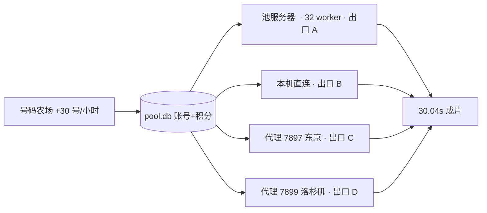

# Seedance 2.5 量产线 · 状态板（2026-10-26 14:35）

## 一句话
**不花钱**：用 Pippit 新号 340 分礼品额度跑 Seedance 2.5，30s / 1080x1920 / 无水印；四条通道并行出片，当前实测 **约 105 条/小时**（池 78 + 本机 27）。

## 架构

## 关键数字（实测）

| 项 | 值 |
|---|---|
| 池内账号 | 455 |
| 池内积分 | 54,817（15:20）|
| 单条 30s 成本 | **122~126 分**（= 实际产出秒数 x 4）|
| 剩余可出 | **≈ 500 条** |
| 已落盘 | **201 条成片 / 10.3 GB** + 214 个中间段 |
| 池服务器 | **78 条/h**（32 worker 全忙）|
| 本机 30 线程 | **27 条/h** |
| capflow | 46 次/h（0 扣分，换号重试即可）|
| 合计 | **≈105 条/h**，按此速度剩余约 4.8 小时 |

## 当前配置（全部由计划任务守护）

| 任务 | 作用 |
|---|---|
| wz_fleet | 本机 fleet：3 分片 x 10 线程（直连 / 7897 / 7899）|
| wz_drivers | 两个 _r106_batch，各 inflight 10，打满池服务器 |
| wz_stats | 每 10 分钟往 <OUTPUT_DIR>\_r155_stats.csv 记一行快照 |
| wz_reaper | 每 15 分钟清服务器 videos（保留 45 分钟）|
| 服务器 | systemctl pippit-pool 8788，WZ_MAX_WORKERS=32 |

## 关键结论（写进 PROTOCOL.md §15）

1. **capflow / 13002 完全 0 扣分**，失败就换号重试，不心疼。
2. **节流是账号维度**：同一个号会连续被打回，必须给 900s 冷却，否则 lease 会把它立刻租回来白烧时间。
3. **扣分 = 实际产出秒数 x 4**（请求 15s 出 3.785s 只扣 15）。
4. **thread_id 禁止复用**：同一 thread 再提交，get_thread 立刻返回上一轮 asset（3.8s / 0 分 = 拿到旧视频）。
5. **14:00 后观测到单段 20.23s 成功** ⇒ 15s 不是硬上限。

## 陷阱清单

- 别用 Start-Process 起长驻进程：约 8 分钟后会被外部回收（无崩溃日志）。一律走计划任务。
- systemctl restart pippit-pool 会把**所有 busy 账号**（含本机租的）刷成 ready ⇒ 顺序必须是「停本地分片 → 重启池 → 起分片」。
- 强杀分片会漏租约；用 _r145_release_orphans.py 清理（只清没被 running/queued 任务引用的）。
- 中文路径写进 .bat 会变 ?：脚本一律 copy 到 <OUTPUT_DIR>\ 再引用。
