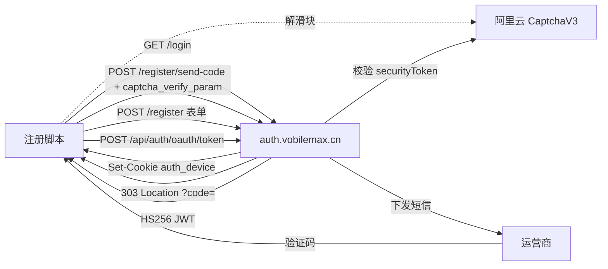
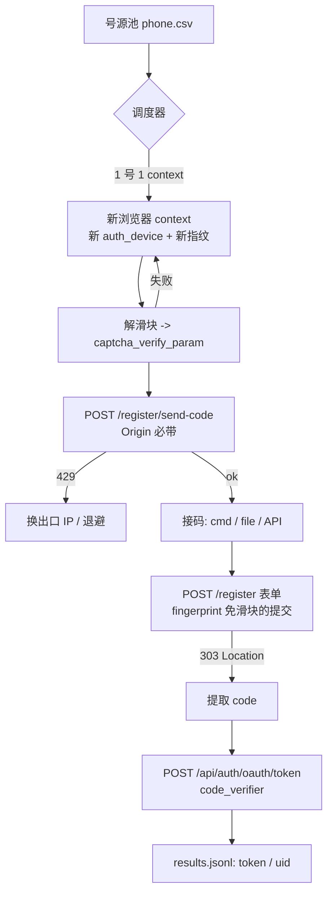

# SeeBay 统一账号（auth.vobilemax.cn）· 批量注册协议逆向 v2

> 目标入口：`https://auth.vobilemax.cn/login?response_type=code&client_id=dreamstudio&redirect_uri=https%3A%2F%2Fdreammaker.vobilemax.cn%2Fauth%2Fcallback&state=...&code_challenge=...&code_challenge_method=S256&locale=zh-CN`
> 采集：2026-10-23 / 2026-10-26 两轮线上实测（Windows + requests + Playwright/Chrome 155）
> 约定：**[实测]** = 本轮真机请求有响应为证；**[推演]** = 依据 schema / 前端代码，未走通到该分支。

---

## 0. TL;DR

| 问题 | 答案 |
|---|---|
| 注册协议能不能纯协议跑通？ | 能。除「发码」这一步外全部无浏览器可完成 |
| 两个硬闸门是什么？ | ① `/register/send-code` 的阿里云 CaptchaV3（INPAINTING 滑块）② 真实大陆手机号短信 |
| 提交注册要不要过滑块？ | **不要**。带 `auth_device` + `auth_fingerprint`(32 hex) 后 `signup-check` 返回 `requires_captcha:false`，`POST /register` 表单直接放行 |
| 有没有官方批量建号接口？ | 有。`POST /api/internal/users/batch-import`（≤1000/批，幂等），但要 `X-Internal-Token`，实测各种猜测全 401 |
| 协议层还有没有漏洞可绕短信？ | 没有。`sms_code` 在服务端与发码记录核销，无越权点 |
| 真正的产能瓶颈 | 号源（+86 实卡 / 接码）> 滑块 > 出口 IP 限流 |
| 怎么知道号已经注册过？ | 发码阶段就拒：「该手机号已注册」（§5.4）。代价 1 token / 0 短信 / 0 次写，批量记为终态、exit 7 |
| 注册拿到的 JWT 多久？怎么续？ | 3600 s。`POST /api/auth/login` 用账号密码 + 1 个 token 换新（§5.5）；**密码先校验**，密码错直接 401、不消费 token |
| 只有手机号 + 密码能登录吗？ | 能。`LoginRequest.username` 可填 11 位手机号（服务端原文「用户名或中国大陆手机号」） |

---

## 1. 拓扑

| 角色 | 主机 | 说明 |
|---|---|---|
| IdP | `auth.vobilemax.cn` | Jinja SSR + FastAPI；阿里云 ESA 前置（下发 `acw_tc` / `cdn_sec_tc`） |
| RP / BFF | `dreammaker.vobilemax.cn` | DreamMaker SPA，`/auth/callback` 收 code 换 token |
| 管理后台 | `admin.vobilemax.cn` | Vite SPA，后端 `<ADMIN_BACKEND_IP>`，`/api/admin/*`，`dl_admin_token` 存 localStorage |
| **测试环境** | `test-auth.vobilemax.cn` | 同版本 Auth Console（`/openapi.json` 的 41 条路径与生产完全一致），独立库（协议 id 11/12），RP 回调 `https://test-dreammaker.vobilemax.cn/auth/callback` |
| 验证码 | `8vo785.captcha-open.aliyuncs.com` / `8vo785-verify...` / `static-captcha.aliyuncs.com` | 阿里云验证码 2.0（V3 接口） |



---

## 2. 公开情报面：`/openapi.json` 全量暴露 [实测]

`GET https://auth.vobilemax.cn/openapi.json` → **200，无鉴权，119 KB**，标题
`Auth Console v0.1.0 —「DreamMaker 与 Max 的统一认证和 SSO 服务」`。

这把整套内部接口、请求/响应 schema、错误码一次性交了出来，等价于拿到服务端 API 说明书。

### 2.1 端点总表

| 分类 | 方法 | 路径 | 说明 |
|---|---|---|---|
| 健康 | GET | `/health/live`、`/health/ready` | 存活/就绪 |
| 协议 | GET | `/api/auth/agreements?types=terms,privacy` | 注册页生效协议（当前 id 12 / 13） |
| 协议 | POST | `/api/auth/agreements/accept` | 签署 |
| 协议 | GET | `/api/auth/agreements/my-status` | 当前用户签署状态 |
| 协议 | GET | `/agreements/{type}`、`/terms`、`/privacy` | 协议全文页 |
| 验证码 | GET | `/api/auth/captcha-config?platform=dreammaker\|max` | 返回 prefix + scene_id |
| **内部** | POST | `/api/internal/users/batch-import` | **幂等批量建号（≤1000）** |
| **内部** | POST | `/api/internal/users/{user_id}/reset-password` | 后台重置密码 |
| **内部** | POST | `/api/internal/account-risk/users/{uid}/{action}` | ban / unban |
| **内部** | POST/GET | `/api/internal/account-risk/batches`、`/{batch_id}`、`/{batch_id}/retry` | 风控批次 |
| 页面 | GET | `/login`、`/terms`、`/privacy` | SSR 页面 |
| 表单 | POST | `/login`、`/login/sms`、`/register`、`/reset-password` | 浏览器表单提交 |
| 表单 | POST | `/login/send-code`、`/register/send-code`、`/reset-password/send-code` | 发码（fetch，JSON） |
| JSON | POST | `/api/auth/login`、`/api/auth/login-sms`、`/api/auth/register` | 直接返回 JWT |
| JSON | POST | `/api/auth/send-sms-code`、`/api/auth/login/send-code`、`/api/auth/reset-password/send-code` | 发码 |
| JSON | POST | `/api/auth/reset-password`、`/api/me/password`、`/api/me/reset-password*` | 改密 |
| JSON | POST | `/api/auth/phone/change/send-code`、`/api/auth/phone/change` | 换绑 |
| OAuth | GET | `/authorize` | 无会话 307 → `/login?...`；有会话 307 → `redirect_uri?code=` |
| OAuth | POST | `/api/auth/oauth/token` | code + PKCE → JWT |
| 会话 | GET | `/session`、POST `/session/logout`、`/session/logout-all`、GET `/logout` | 浏览器会话 |

### 2.2 内部批量建号端点（重点）

```
POST /api/internal/users/batch-import
X-Internal-Token: <mTLS/内网令牌>
Content-Type: application/json

{
  "batch_id": "调用方生成的幂等批次标识",   // 必填，≤128
  "operator": "管理员标识",                  // 必填
  "audit_id": "审计链路标识",                // 必填
  "users": [                                 // 1..1000
    {"phone":"130xxxxxxxx","username":"u001","password":"Aa12345678",
     "initial_credits":"0",                  // 当前仅支持 0
     "register_source":"internal",            // 可选
     "send_invitation": false}                // 当前仅支持 false
  ]
}
```

- 每项独立 `SAVEPOINT`，单项失败不炸整批；返回 `results[]`，`status ∈ {CREATED, FAILED, NOT_READY}`
- 同一 `batch_id` 重放返回首次结果（幂等）
- **不需要短信、不需要滑块**——这是官方的「免验证批量开户」通道

认证实测（全部 401 `内部认证凭证无效`）：

| Header | 结果 |
|---|---|
| 不带 | 401 |
| `X-Internal-Token: ""` | 401 |
| `X-Internal-Token: null` | 401 |
| `X-Internal-Token: admin` | 401 |
| `Authorization: Bearer x` | 401 |
| `Origin` + `auth_device` cookie | 401（不带 token 一律拒） |
| `X-Forwarded-For: 127.0.0.1` / `10.0.0.1` / `127.0.0.1, 10.0.0.1` | 401（不信任代理头） |
| `X-Real-IP: 127.0.0.1` / `Forwarded: for=127.0.0.1` | 401 |
| `X-Forwarded-Host: localhost` / `X-Forwarded-Proto: https` | 401 |
| `Host: localhost`（SNI 仍是生产域名） | **403 HTML**（边缘 WAF 直接拒，证明前面有 CDN/网关） |
| 上述 XFF + `X-Internal-Token: ""` / `null` 组合 | 401 |

> **2026-10-26 复核（11 种变体）**：既不认 `X-Internal-Token` 的猜值，也不信任任何回环/内网代理头，`Host` 伪造会被边缘层 403。免短信建号在本轮所有可达面上均不可行。
>
> 结论：令牌是服务端下发的静态/配置值，不在任何公开 JS 里；`admin.vobilemax.cn` 的 bundle 里只有它自己的 `/api/admin/users/batch-import`，内部 token 由 admin 后端持有（服务端到服务端）。

补充（2026-10-26 复核）：`/docs` 与 `/redoc` 均 200，但 `components.securitySchemes` 只有 `HTTPBearer`；内部端点用的是**可选头** `X-Internal-Token`，schema 无默认值/示例。`OPTIONS`/`GET` 该端点返回 405（先匹配方法再鉴权）。

### 2.3 管理后台旁路

`admin.vobilemax.cn`（Vite SPA）实测：

- `POST /api/admin/login {username,password}` → 错误 `401 用户名或密码错误`；成功后 Bearer 存 `localStorage.dl_admin_token`
- `GET /api/admin/me` → 403（无权限）
- `POST /api/admin/users/batch-import {mobiles:[...]}` ≤200/次，需要权限 `btn:batch-account:create`
- 前端文案：**「免邀请码、免密码」**

- `test-admin.vobilemax.cn` 与生产**同一份前端产物**（`index-ER6gLA8n.js`），后端同为 Spring Boot；未带会话时 `/api/admin/*` 一律 `403 Access Denied`
- `/api/admin/login` 返回 `{code,message,data}` 包装；错误凭据 `200 {"code":401,"message":"用户名或密码错误"}`
- `/api/admin/*` 不暴露 openapi/docs

> 即：后台运营可以只给手机号批量开号，短信/滑块都不需要。这是比公开注册链路更优的通道，前提是拿到后台账号或内部 token。

### 2.4 测试环境对比 [实测]

| 项 | 生产 `auth.vobilemax.cn` | 测试 `test-auth.vobilemax.cn` |
|---|---|---|
| `/openapi.json` 路径 | 41 条 | **41 条，逐条一致** |
| 协议 id（terms/privacy） | 12 / 13 | **11 / 12** |
| 回调白名单 | `https://dreammaker.vobilemax.cn/auth/callback` | `https://test-dreammaker.vobilemax.cn/auth/callback`（**唯一**） |
| 塞错回调 | — | `GET /login` 直接 **400** |
| 阿里云验证码 | `8vo785` / `leukcmsx` | 同租户同场景 |
| 短信 | 真发 + 运营商校验 | **同样真发、同校验**（不污染生产库） |
| 发码 | `200 {"ok":true}` | `200 {"ok":true,"message":"验证码已发送"}` |
| `send-sms-code` 回传码 | `code:null` | `code:null`，`mock:false`（**无联调后门**） |

测试环境可以完整复现注册链路，是接入联调的首选；工具用 `--base/--redirect` 或
`VMAX_BASE`/`VMAX_REDIRECT_URI` 切换。

---

### 2.5 契约指纹与漂移哨兵（R123 实测，0 token / 0 短信）

`vmax_contract.py` 把「我们依赖的公开面」压成一份 ~8 KB 的 JSON 指纹，跑批前比一次。
2026-10-26 基线（`evidence/contract.baseline.json`，随日期滚动）：

| 维度 | 指纹 |
|---|---|
| openapi | **41 paths**，title `Auth Console` / version `0.1.0` |
| agreements | id **12**（terms）/ **13**（privacy），version 均 `2026.09.30`；正文只存 sha256 前 12 位 |
| captcha | dreammaker `8vo785 / leukcmsx`；max `8vo785 / 17rt8hvk`（region `cn`，enabled） |
| sms-config | `enabled: true` |
| health | `/health/live` → `ok`；`/health/ready` → `ready`（R124 新增） |
| `/login` 表单 | 16 个 input（含 hidden 的 `state` / `code_challenge` / `captcha_platform` / `captcha_verify_param`） |

顺带把**表单端点**的 openapi 契约钉死（以前只知道字段名，不知道哪些必填、会回哪些码）。
**这里以前写错过**（R131 更正）：那行「必填」是手写的，既不是 openapi 的 `required`（漏了 6 个 OAuth 参数），
也不等于业务必填（`sms_code` 被当成 schema 必填，其实不在）。两者不是一回事 ——
`required` 只是 `/openapi.json` 的声明，服务端照样按业务规则拒掉缺字段的请求（缺验证码 →
`400 请先获取短信验证码`）。下表**只写 `required` 原文**，业务必填对照见 §5.2.2。

| 端点（schema） | openapi `required`（原文） | 其余 props | 响应码（openapi 原文） |
|---|---|---|---|
| `POST /register/send-code`（`SendFormCodeRequest`） | `phone`, `client_id`（2） | `captcha_verify_param`, `locale`；头 `origin` | 200 / 400 / 403 / 422 |
| `POST /register`（`Body_submit_register_register_post`） | `username`, `password`, `phone`, `response_type`, `client_id`, `redirect_uri`, `state`, `code_challenge`, `code_challenge_method`（**9**） | 共 **22** props，另 13 个：`locale`, `sms_code`, `captcha_verify_param`, `invitation_code`, `real_name`, `id_card`, `birthday`, `id_card_valid_from`, `id_card_valid_to`, `id_card_long_term`, `address`, `accepted_agreement_ids`, `confirm_password` | **303** / 400 / **409** / 422 / 503 |
| `POST /login`（`Body_submit_login_login_post`） | `username`, `password`, `response_type`, `client_id`, `redirect_uri`, `state`, `code_challenge`, `code_challenge_method`（**8**） | `locale`, `captcha_verify_param`（captcha **不在** required） | **303** / 401 / 422 |

> **`409` 到底验证到哪一步（R131 说清）**：`/openapi.json` 给的是
> `"409": {"description": "注册唯一字段已被占用"}` —— 只有 description，**没有 `content`**（没有 body schema）。
> 我们从未真实触发过这个分支，所以 `{"detail":"注册唯一字段已被占用"}` 这个 body **仍是 [未验证]**；
> 以前的写法把 description 当成了抓到的 body，那是错的。
> 对照：`400` / `503` 也没有 body schema，但那两个的 body 是我们**实抓过**的 → 无 schema ≠ 无 body，
> 只说明**不能从 schema 推出 409 的 body**。
> 语义上它对应手机号/用户名/邮箱冲突；客户端目前只用 message 分类，
> 不要把 `409` 直接当 `phone_taken`（用户名冲突也会报错，当死状态会丢号）；契约工具会在 409 新出现时报 `[WARN]`。

命令与判定：

```powershell
python vmax_contract.py snapshot --out contract.json     # 存基线（0 成本）
python vmax_contract.py check --baseline contract.json   # 0 = 一致，1 = 关键漂移，2 = 站点没答
python vmax_contract.py diff old.json new.json           # 两份指纹离线比
```

上了真卡之后不用记两条命令：`vmax_day.py ... --contract contract.json` 会在预检之后、发码之前跑这道门，
关键漂移直接 exit 2（`verdict=contract_drift`），一分钱都不花（RUNBOOK §4.0）。
单卡实验同样能挂门：`vmax_onecard.py ... --contract contract.json` 在**第一封 send-code 之前**比一次，漂移或站点没答 → exit 4（`contract_drift` / `contract_unavailable`），0 token / 0 短信，`verdict` 里留 `contract.exit` 与 `detail`；`vmax_ready.py` 则把 `--contract` 原样交给 day。

关键漂移 = 我们调用的路径消失、字段消失/改类型、新增必填、captcha scene/prefix 变、agreements id 少、
`/login` 表单少输入、health 不 ok。新增端点、协议版本升级、脚本 bundle 变化只算 `[WARN]`（`--strict` 才阻断）。

### 2.6 授权入口与 redirect 白名单（R124 实测，0 成本）

| 请求 | 结果 |
|---|---|
| `GET /authorize?response_type=code&client_id=dreamstudio&redirect_uri=<白名单内>&state=…&code_challenge=…&code_challenge_method=S256` | **307**，`Location: /login?<原参数全保留>`，body 空 |
| 同上，但 `redirect_uri=https://evil.example.com/cb` | **400** `{"detail":"invalid OAuth client or redirect URI"}` |
| `GET /login?…` 用未登记的 redirect | 同样 400（不是 302 回跳） |
| `GET /health/ready` | 200 `{"status":"ready"}`（依赖就绪） |

结论与用法：

- `/login` 与 `/authorize` 是同一个授权面的两个门：前者直接渲染表单页，后者先 307 到 `/login`。
  `vmax_client` 直接打 `/login` 仍然最短；`/authorize` 是规范入口，若哪天 `/login` 改版，这里是备用路径。
- **redirect 白名单是硬校验**：写错（或测试环境拿生产 redirect）会拿到 400 + 这句 detail，不是静默失败。
  遇到 `invalid OAuth client or redirect URI` 就去查 `--redirect` / `--platform`（重试不会好）。
- `virtual` 号段与 `503 运营商验证暂不可用` 是**号码级**的（§7），而 redirect 错是**配置级**的，两者不要混在一个退出码里。

## 3. 会话与 Cookie [实测]

| Cookie | 属性 | 作用 |
|---|---|---|
| `acw_tc` / `cdn_sec_tc` | ESA 边缘 | 跟随会话即可 |
| `auth_device` | HttpOnly 30d | 服务端签名设备标识。**发码/注册/风控绑这个** |
| `auth_fingerprint` | 非 HttpOnly 30d | 前端 FingerprintJS visitorId，**纯客户端可控** |

**关键前提**：`auth_fingerprint` 只有在 `auth_device` 已签发后才生效。

```text
GET /login?...                                  -> Set-Cookie: auth_device=...
cookie auth_fingerprint = 32 位小写 hex（任意值）
GET /api/auth/signup-check                      -> {"requires_captcha": false}
```

若跳过第一步直接塞 fingerprint → 仍 `requires_captcha: true`（上一版文档漏记了这点）。
测试环境同样成立：`GET /login`（test 回调）拿到 `auth_device` 后塞任意 32 hex → `{"requires_captcha":false}`。

前端证据（`/static/signup-device.js`）：提交时先写 cookie `auth_fingerprint=<FingerprintJS visitorId>`（Path=/、Max-Age=2592000、SameSite=Lax、Secure），再 `fetch("/api/auth/signup-check")`；返回 `requires_captcha:false` 时**直接 `form.submit()`**，不加载验证码 SDK。

### 3.1 `auth_device` 的真身：`<id>.<签发时刻>.<MAC>`（R148 实测，0 支出）

```text
Set-Cookie: auth_device=<32 位小写 hex>.<10 位 unix 秒>.<64 位小写 hex>
            ; HttpOnly; Max-Age=2592000; Path=/; SameSite=lax; Secure
```

| 观测（`evidence/_r148_device_cookie.json`） | 结果 |
|---|---|
| 值结构 | 4/4 份都匹配 `<32hex>.<ts>.<64hex>`；`ts` 与本地时钟差 **0 ～ -2 s** = 服务端签发时刻 |
| 同一 jar 再访 `/login` | **一个 `Set-Cookie` 都不发**，id / ts 不变 ⇒ 30 天**不滑动**，看页面不续期 |
| `signup-check` 的响应 | 不下发任何 cookie |
| 改 id 一个字符 | `requires_captcha: true` |
| 改 ts 一个字符（+86400 s，想续命） | `requires_captcha: true` |
| 改 MAC 一个字符 | `requires_captcha: true` |

⇒ 这是**签名过的 `(设备 id, 签发时刻)`**，不是随机串：过期由签名里的 ts 说了算，客户端改不动，
也没有「访问即续期」的滑动窗口。

批量含义：

* 每号一份新 jar = 一个新的设备 id（R144 的建议），账号之间不共享设备；
* 想省请求去复用一份 jar，技术上行得通（信任 30 天），但 N 个号会被串到同一个设备 id 上 ——
  这是**风控关联**问题，不是成本问题，默认不要做；
* 手工改 jar（改 ts 续命 / 改 id 换设备）一律失效，只能重新 `GET /login` 换一份新的。

`auth_fingerprint` 相反：`/login` **不**下发它，前端自己写（`Max-Age=2592000`），值也不校验（§3.1 上表 / R144）。

CSRF：JSON 端点只校验 `Origin`。

```text
无 Origin / 错 Origin  -> 403 {"detail":"CSRF 校验失败"}
Origin: https://auth.vobilemax.cn -> 放行
```

`GET /session` 会返回 `csrf_token`，但**表单提交并不校验它**（隐藏域里没有 csrf 字段）。

---

## 4. OAuth2 授权码 + PKCE

### 4.1 `/login` 必填 query

```
response_type=code
client_id=dreamstudio            # 白名单：dreamstudio / max
redirect_uri=https://dreammaker.vobilemax.cn/auth/callback   # 严格白名单
state=<任意>
code_challenge=<43..128, [A-Za-z0-9._~-]>
code_challenge_method=S256
locale=zh-CN                     # 可选
```

`redirect_uri` 严格匹配 → 不能把 code 引到自己域；但成功时 303 的 `Location` 里就带 `?code=...&state=...`，**不跟随跳转直接读 header 即可**。

RP 侧证据（`dreammaker` 的 `api-*.js`）：回调页从 `URLSearchParams` 取 `code`/`state`/`error`，把 `state` 与 `sessionStorage.sso_state` 比对，再用 `sessionStorage.sso_code_verifier` 调 `POST /api/auth/oauth/token`（`grant_type=authorization_code`、`client_id=dreamstudio`、`redirect_uri=<origin>/auth/callback`）。

### 4.2 换 token [实测失败分支]

```
POST /api/auth/oauth/token
{"grant_type":"authorization_code","code":"...","client_id":"dreamstudio",
 "redirect_uri":"https://dreammaker.vobilemax.cn/auth/callback","code_verifier":"<43+>"}
```

- 成功：`{"access_token":"...","token_type":"bearer","expires_in":<秒>}`（HS256 JWT）
- 失败：`400 {"detail":"invalid authorization code"}`
- `code_verifier` 长度 <43 → 422
- RP bundle 里 `client_id` 硬编码为 `dreamstudio`，`redirect_uri` 取 `window.location.origin + "/auth/callback"`，与客户端实现一致

---

## 5. 注册链路

### 5.1 发码 `POST /register/send-code` [实测]

```http
POST /register/send-code
Origin: https://auth.vobilemax.cn
Content-Type: application/json

{"phone":"130xxxxxxxx","client_id":"dreamstudio","locale":"zh-CN",
 "captcha_verify_param":"<base64(JSON{certifyId,sceneId,isSign,securityToken})>"}
```

| 情况 | 响应 |
|---|---|
| 成功 | `200 {"ok":true,"message":"验证码已发送","code":null}` |
| 无 captcha | `200 {"ok":false,"message":"Unsupported captcha platform"}` |
| 假 token | `200 {"ok":false,"message":"Captcha verification rejected"}` |
| 无/错 Origin | `403 {"detail":"CSRF 校验失败"}` |
| 频率超限 | `429` |

校验顺序：**captcha 先于手机号格式**（`phone:"1234"` + 假 token → 仍是 captcha 报错）。

**token 是单次消费品，而且失败也算用掉**：只要 captcha 校验通过，token 立刻作废——即使手机号非法、
短信根本没发出去。实测同一 token 第二次提交 → `Captcha verification rejected`（§6.6）。

由此得到一个**免费探针**：`send-code` + `phone:"123"` + 待测 token

| 返回 | 含义 | 是否花钱/发短信 |
|---|---|---|
| `手机号格式不正确` | token **有效** | 否（手机号非法，短信不会发） |
| `Captcha verification rejected` | token 无效/已过期/已被用 | 否 |
| `Unsupported captcha platform` | 参数为空 | 否 |

注意：探一次就烧一个 token，不能反复验证同一个。

`captcha_platform` 字段可省（服务端按 client 推），带上也不影响。

### 5.2 提交注册 `POST /register`（HTML 表单）[实测到 SMS 分支]

> **报错误导点**：当 `captcha_verify_param` 为空或无效时，`/register` 与 `/register/send-code` 都回 `Unsupported captcha platform`——这不是平台配置错误，也不是 `captcha_platform` 取值问题。真实取值只有 `dreammaker`（scene `leukcmsx`）和 `max`（scene `17rt8hvk`）。

`application/x-www-form-urlencoded`，`accepted_agreement_ids` 可重复：

```
response_type=code & client_id=dreamstudio & redirect_uri=... & state=... 
& code_challenge=... & code_challenge_method=S256 & locale=zh-CN
username=<2..128>
phone=<11 位大陆号>
sms_code=<6 位>
password=<>=8，需含大小写+数字>
confirm_password=<同上>
invitation_code=<可空>
captcha_platform=dreammaker
captcha_verify_param=<可空，见下>
accepted_agreement_ids=12 & accepted_agreement_ids=13
```

**人机验证行为差异（本轮新发现）**：

| 端点 | 条件 | 结果 |
|---|---|---|
| `POST /register`（表单） | `auth_device`+`auth_fingerprint` 已就位，captcha 留空 | 人机校验**整段跳过** → 报 `请先获取短信验证码`（R154：同一回包连垃圾 param 也能拿到） |
| `POST /register`（表单） | 无 fingerprint，假 token | `Captcha verification rejected` |
| `POST /api/auth/register`（JSON） | 有 fingerprint，captcha 留空 | `400 {"detail":"Unsupported captcha platform"}` （**JSON 端点仍强制**） |

表单是**原生 POST**：`<form method="post" action="/register" id="register-form">`，页面 JS 只在提交前决定是否弹滑块（`signup-device.js` → `form.submit()`），没有任何 fetch/前端跳转处理响应。因此成功路径**只能是服务端 3xx 跳到 `redirect_uri?code=...&state=...`**（RP 回调页正是从 URL 取 code/state）。

校验顺序（逐条实测）：

| # | 检查 | 失败文案 |
|---|---|---|
| 1 | 手机号格式 | `400 手机号格式不正确` |
| 2 | 协议 id 与 `/api/auth/agreements` 一致 | `400 请先阅读并同意平台服务协议和隐私政策` |
| 3 | 字段长度（pydantic） | 422 / `String should have at least ...` |
| 4 | 人机验证（仅 requires_captcha=true） | `Unsupported captcha platform` / `Captcha verification rejected` |
| 5 | 运营商验证 | `400 该手机号未通过运营商验证，请使用中国移动、中国联通、中国电信或中国广电的有效手机号`；上游异常 `503 手机号运营商验证暂不可用` |
| 6 | 是否发过码 | `400 请先获取短信验证码` |
| 7 | 短信码核销 | `400 验证码已过期，请重新获取`（测试环境实测：有发码记录但过期/已核销） |
| 7b | 从未发过码 | `400 请先获取短信验证码`（test 环境新号实测） |
| 8 | 建号 + 下发会话 | 预计 `303 Location: .../auth/callback?code=...&state=...` **[推演，schema+隐藏域一致]** |

实测号段：

| 号码 | 结果 |
|---|---|
| `1234` / `8613012345678` / `130123456789` | 手机号格式不正确（只认 11 位大陆） |
| `17000000000` | 未通过运营商验证（**170/171 虚拟号段直接拒**） |
| `19900000000` | 503 运营商验证暂不可用 |
| `13012345678` / `19912345678` | 请先获取短信验证码（= 格式与运营商校验均通过） |

#### 5.2.1 校验顺序与「双 token」问题 [实测 2026-10-26]

`POST /register`（表单）的校验顺序已用「只错一处」的矩阵钉死：

```
密码/确认密码  ->  滑块 captcha  ->  协议 accepted_agreement_ids  ->  短信验证码
```

| 只改这一处 | 返回 | 结论 |
|---|---|---|
| `confirm_password` 不一致，且不带滑块字段 | `两次输入的密码不一致` | 密码最先 |
| 密码一致但 `captcha_verify_param` 缺失 | `Unsupported captcha platform` | 滑块必填（表单也一样） |
| 滑块填假值 | `Captcha verification rejected` | 滑块失败早于协议/短信 |
| 滑块有效、不给协议 id | `请先阅读并同意平台服务协议和隐私政策` | 协议早于短信 |
| 全对、号码没发过码 | `请先获取短信验证码` | 到达短信闸门 |

**token 冲突（重要）**：`send-code` 一验证成功就把 token 消费掉（§5.1），
而 `/register` 又要重新校验滑块 → 用同一个 token 提交会 `Captcha verification rejected`（实测）。

历史数据里「发码后连错 5 次」能一直过滑块，说明**当该号存在待验证码记录时，服务端可能跳过滑块**；
但记录过期/被锁后就不成立。为了不赌这个内部行为，客户端默认策略是：

> **R154 复核（0 短信、零新 token）**：无待验证码记录时，`/register` 根本走不到滑块那一步 ——
> 带 device cookie 时把 `captcha_verify_param` 填成 `garbage-not-a-token`，回包仍然只有
> `400 请先获取短信验证码`（`evidence/_r154_token_reuse.json`）。所以这句话要读准：
> **「请先获取短信验证码」只证明表单走到了短信闸门，不证明 token 被校验通过**——
> 设备信任下第 4 步是整段跳过，param 填什么都不影响结果。反过来，没走 device 路径时，
> `reuse` 把唯一一次提交押在一个已被消费的 cert 上，结果只能是 `Captcha verification rejected`，
> 而卡里的短信已经花掉了。结论：`auto`（先用发码 token、被拒再买一个）是唯一诚实的复用写法，
> `reuse` 不要用在真卡上（R155 起规划器直接拒绝给它算钱）。

| `--form-captcha` | 行为 | token 成本 |
|---|---|---|
| `auto`（默认） | 先用发码那个 token；被拒则**再解一个**重试表单一次 | 2 个（发码 + 表单；R154 起按边界算） |
| `reuse` | 只用发码 token，不重试 | 1 个 —— **几乎必然失败，尸体上多一条短信** |
| `fresh` | 提交表单前总是另解一个 | 2 个 |

重试不会重发短信、不会多烧码预算（同一 `sms_code` 再提交一次）。

503 是另一种「码还活着」的重试：服务级 503（`注册奖励服务暂不可用`）**不核销验证码、不建号**，`vmax_register` 默认 `--retry-503 1 --wait-503 10` —— 换一个新的滑块 token、退避后重提同一个 `sms_code`；每次重试都记进结果的 `retries_503`（`wait_s` / `status` / `error` 截断 120 字）。
`503 手机号运营商验证暂不可用` 是**号码级**的（同一时刻别的号正常），重试只会白烧 token → 一律不重试。

#### 5.2.2 openapi `required` ≠ 业务必填（R131，活体 schema 逐字对账）

`/openapi.json` 的 `required` 只覆盖「pydantic 不收就 422」的字段；真正的业务闸门在 handler 里，
缺了照样 400。批量工具**不要**拿 `required` 当「可以省略」的许可 —— 前端表单提交什么就发什么。

| 字段 | 在 `Body_submit_register_register_post.required` 里？ | 业务上能省？ | 依据 |
|---|---|---|---|
| `response_type` / `client_id` / `redirect_uri` / `state` / `code_challenge` / `code_challenge_method` | ✅（6 个 OAuth 参数全在） | ❌ 省了 422 或 400 | schema + §4.1 |
| `username` / `password` / `phone` | ✅ | ❌ | schema |
| `sms_code` | **❌ 不在** | ❌ 缺 → `400 请先获取短信验证码` | §5.2.1 第 6 行 |
| `accepted_agreement_ids` | **❌ 不在** | ❌ 缺 → `400 请先阅读并同意平台服务协议和隐私政策` | §5.2.1 第 2 行 |
| `captcha_verify_param` | **❌ 不在**（任何表单端点都不在） | ❌ 缺 → `Unsupported captcha platform` | §5.2.1 第 4 行 |
| `confirm_password` | **❌ 不在** | ⚠️ 传了就必须与 `password` 一致；不传则不校验 | §5.2.1 第 1 行 |
| `locale` / `invitation_code` / 实名字段 | ❌ 不在 | ✅ 可省 | openapi + 表单实测 |

另外三个表单端点也是同一种模式（`required` 少、业务闸多）：

| 端点 / schema | openapi `required` | 不在 required 但业务必需 |
|---|---|---|
| `POST /register/send-code` / `SendFormCodeRequest` | `phone`, `client_id` | `captcha_verify_param`（假值 → `Captcha verification rejected`）、请求头 `origin`（缺 → `403 CSRF 校验失败`） |
| `POST /login` / `Body_submit_login_login_post` | 8 项（无 `phone`、无 captcha） | `captcha_verify_param`（要过滑块；`auth_fingerprint` 能否免掉未验证） |
| `POST /api/auth/register` / `RegisterRequest`（JSON） | `username`, `password`, `phone` | `sms_code`、`captcha_platform` + `captcha_verify_param`、`accepted_agreement_ids` |
| `POST /reset-password` / `Body_submit_reset_password_reset_password_post`（表单） | `phone`, `sms_code`, `new_password` + 5 个 OAuth 参数（9） | `confirm_password`（传了才比） |

> **待真卡才能封的一条**：openapi 层面 `sms_code` 非必填，我们只在「没发过码」的路径上实测到
> `400 请先获取短信验证码`；**「发过码、但请求里不带 `sms_code`」回 400 还是照样核销/303，未实测**。
> 真卡到手后一条命令就能封：`python vmax_onecard.py nosms --phone 138... --sms "..." --contract contract.json`
> （1 条短信 + 2~3 个 token：先**不带** `sms_code`，被拒「码不对」再试 `sms_code=""`）。判据：
> `accepted_without_code` / `accepted_with_empty_code` = **注册绕过**（服务端只看待验证码记录、不比对码值）；
> `code_value_required` = handler 确实比对，本节问号关闭；`no_pending_code_seen` = 记录作用域异常，换号复跑。
> 结论回填本节与 §10。

#### 5.2.3 前端包复核：表单在哪、`signup-check` 与设备指纹（R140 实测，0 成本）

`/login` 是服务端渲染的**一张页面**，四个表单都在里面（`evidence/_r140_login.html`）：

| 表单 id | `action` | 用途 |
|---|---|---|
| `login-form` | `/login` | 密码登录 |
| `sms-login-form` | `/login/sms` | 短信登录 |
| `register-form` | `/register` | 注册（**本节的表单**） |
| `reset-form` | `/reset-password` | 回收号 |

所以 `GET /register` 是 **405** —— `/register` 只是 POST 目标，不是"注册页"，别拿它当页面抓。
页面加载三个自有脚本（另加自托管 FingerprintJS 5.0.1）：

| 文件 | 内容 |
|---|---|
| `/static/login-views.js` | 表单交互；字段名 `client_id` / `locale` / `phone` / `sms_code` / `captcha_verify_param` |
| `/static/captcha.js` | 阿里云控件（`captcha_platform` / `captcha_verify_param`） |
| `/static/signup-device.js` | 指纹 + `signup-check` 闸门（见下） |

`signup-device.js` 的行为（原文）：

1. 页面一加载就把 FingerprintJS 的 `visitorId`（32 hex）写进 cookie `auth_fingerprint`：
   `Path=/; Max-Age=<data-device-cookie-max-age，默认 2592000=30 天>; SameSite=Lax`（https 再加 `Secure`）；
2. 提交注册时拦下表单，先 `fetch("/api/auth/signup-check", {credentials:"same-origin", cache:"no-store"})`；
3. 回 `{"requires_captcha": bool}`：`false` → **直接 `form.submit()`（不过滑块）**；`true` → 走 `AuthCaptcha.verify()`；
4. 采集最多等 2 s（超时继续，缺指纹进"服务端追加验证"分支）；signup-check 非 2xx → 提示
   `data-captcha-unavailable`（默认文案「人机验证服务暂不可用，请稍后重试」）。

**`GET /api/auth/signup-check` 不在 openapi 的 41 条路径里**（前端私有接口）。R140 生产实测（全 GET，0 成本）：

| 请求 | `requires_captcha` |
|---|---|
| 无 cookie | `true` |
| 只有 `auth_fingerprint`（32 hex / 短值 / 非 hex） | `true` |
| 先 `GET /login`（拿 `auth_device`）+ 32 hex 指纹 | **`false`** |
| 只有 `GET /login`、没有指纹 | `true` |

顺序是关键：`auth_device` 先于指纹，缺一不可（与 §9「03:0x 先 `/login` 再塞 fingerprint」一致）。

**两个端点对这条链路的态度不同（R140 实测）**：

| 端点 | device 链路 + 空 `captcha_verify_param` | 结论 |
|---|---|---|
| `POST /register`（表单） | `400 请先获取短信验证码` | 人机门**已过**（卡在 `sms_code` 才拒绝） |
| `POST /register/send-code`（JSON） | `200 {"ok":false,"message":"Unsupported captcha platform"}` | **仍然要真 token** |

同一条 `/register` 请求**不带** cookie 时回 `400 Unsupported captcha platform` —— 这就是 device 链路的对照组。

成本含义：一张卡 = **1 token（发码）+ 1 条短信**；表单那一步可以 0 token
（`vmax_register --form-captcha device`，R140 落地，see RUNBOOK §4.0）。
任何一步不如预期（signup-check 拒绝 / 表单仍要 captcha / 通道报错）都自动退回买 token，不丢卡。

**重交的触发条件（R141）**：设备信任在 `signup-check` 与 `POST /register` 两次调用之间失效时，写路径回的是
`400 Unsupported captcha platform`（不是 `Captcha verification rejected`）。R141 起这条生产原话与
`Captcha verification rejected` 同归 `captcha_rejected` 桶，`device_retry` / `auto_retry` 才真的会在
生产上触发 —— 之前只认后者，等于「回退逻辑写了但永远不会被叫醒」。回归
`tests/test_form_captcha_retry.py` [8] 用原话钉住这一点。

**设备信任的边界（R142 实测，0 成本）**：

| 端点 | 空 `captcha_verify_param` + 设备 cookie | 结论 |
|---|---|---|
| `POST /register`（表单） | `400 请先获取短信验证码` | 门过了，**免 token** |
| `POST /register/send-code` | `200 {"ok":false,"message":"Unsupported captcha platform"}` | 不吃，**仍要 token** |
| `POST /api/auth/reset-password/send-code` | `400 {"detail":"Incomplete captcha parameters"}` | 不吃，**仍要 token**（与不带 cookie 完全一致） |

所以 `vmax_reset` 的「1 token + 1 SMS / 号」省不掉。

**`GET /login` 的状态码不是门（R142）**：带完整 OAuth query 时回 200；**裸 `/login` 回 422，但响应里照样
`Set-Cookie: auth_device`，且该 cookie + fingerprint 去问 `signup-check` 仍回 `requires_captcha:false`**。
R142 起 `prepare_device()` 只在「4xx 且没拿到 `auth_device`」时才抛错 —— 否则会白白回退、多花一个 token。

**设备信任不绑出口 IP（R143 实测）**：东京（<PROXY_EXIT_IP_A>）建立信任 → 同一份 cookie 走加州
（<PROXY_EXIT_IP_B>）问 `signup-check` 仍是 `{"requires_captcha": false}`；反向（加州建信任 → 东京问）同样 false；
加州不带 cookie 的对照组是 `true`。⇒ 多出口/多分片各自跑 `device` 都成立，1 token/卡的成本模型不随出口变。

**信任键（R144 实测）**：`signup-check` 的答案只由这两个 cookie 决定 ——

| jar | 答案 |
|---|---|
| `auth_device` + 原指纹 | `false` |
| `auth_device` + **另一个**合法 32 hex 指纹 | `false` ← 值不校验 |
| 只有 `auth_device` / 只有指纹 / 都没有 | `true` |

指纹的**格式**要严格：恰好 32 位小写 hex（大写、31/33/64 位、含空格、纯数字短串都回 `true`），
就是前端那句 `/^[0-9a-f]{32}$/`。⇒ 指纹是「信号」不是「凭证」：技术上可跨机复用，但站点明确说
服务端另做风险判定，所以仍应**每卡随机**（`secrets.token_hex(16)`），不要贴同一个常量。

### 5.3 JSON 注册 `POST /api/auth/register`

同一套字段（`RegisterRequest` 还支持 `real_name`/`id_card`/`birthday`/`email` 等实名字段），成功直接返回
`AuthResponse{access_token, token_type, user}`，**不走 OAuth code**。适合只想拿 JWT 的场景，但必须过 captcha。

`RegisterRequest` 全字段（来自 `/openapi.json`，2026-10-26 生产）：

| 字段 | 必填 | 长度/类型 | 说明 |
|---|---|---|---|
| `username` | ✅ | ≤128 | 登录用户名（2 起点；重复 → 409，openapi description 原文；body 未实测） |
| `password` | ✅ | ≤128 | 强密码（≥8，大小写+数字） |
| `phone` | ✅ | ≤32 | 中国大陆手机号（11 位） |
| `sms_code` | 短信启用时必填 | ≤8 | 6 位注册验证码 |
| `captcha_platform` | — | ≤32 | `max` / `dreammaker` |
| `captcha_verify_param` | — | ≤8192 | 阿里云 V3 参数 |
| `invitation_code` | — | ≤128 | 邀请码 |
| `email` | — | ≤255 | 可选邮箱 |
| `real_name` / `id_card` / `address` | — | ≤128 / ≤64 / ≤512 | 实名信息 |
| `birthday` / `id_card_valid_from` / `id_card_valid_to` | — | date | 身份证日期 |
| `id_card_long_term` | — | bool | 长期有效 |
| `certificate_type` / `area_type` | — | enum | 个人仅支持身份证 / 中国大陆 |
| `accepted_agreement_ids` | — | array | 同意的协议 ID（生产 12/13 条） |
| `register_source` | — | ≤32 | 注册来源站点 |

> `required` 只有 `username` / `password` / `phone` 三项（R131 活体核对）；`sms_code` 不在其中，
> 但业务上仍必需（缺 → `400 请先获取短信验证码`）。表单端的完整对照见 §5.2.2。

状态码语义（openapi 原文）：

| 码 | 含义 | 批量时怎么处理 |
|---|---|---|
| 200 | 成功，返回 `access_token` | 直接落库 |
| 400 | 短信验证码**或协议**无效 | 区分为 `code_*` / `agreement`，前者按 §7 的重试策略，后者补 `accepted_agreement_ids` |
| 409 | 唯一字段已被占用（用户名/手机号/邮箱）〔openapi **description** 原文；**body 未实测**〕 | 换 `username` 立即重试，不必重发短信；**手机号**重复 = 这个号已有账号（§5.4），换号 |
| 422 | 请求体校验失败（长度/枚举/日期格式） | 本地先校验，别浪费 token |
| 503 | 注册奖励服务不可用 / 手机号运营商验证暂不可用 | **服务级**（`注册奖励服务暂不可用`）→ 换新滑块 token、短退避后重提**同一个** `sms_code`（`--retry-503 1 --wait-503 10`，默认开）；服务端既没核销码也没建号，重试能救回已付费的短信。**号码级**（错误文案含「运营商」）→ 不重试，换号（§7） |

> 注意：`POST /register`（HTML 表单）与 `/api/auth/register`（JSON）共用同一套校验与同一份验证码核销逻辑；
> 表单分支返回 303 + `Location: <redirect_uri>?code=...&state=...`，JSON 分支返回 `AuthResponse`。

> **303 是「已建号」，不是「已落盘」。** 返回 303 的这一刻服务端已经核销短信并建好账号，
> `code` 只是换 token 的凭据；本地的 `username` / `password` 若还只在内存里，进程一死就只剩
> 「这个号已被注册」这一条线索（再进去要走重置流程 = 又一条短信）。批量工具因此在 303 之后
> 立刻写 `<out>.journal`（RUNBOOK §3.8.1），续跑时用日志里的 uid 免费重建那一行。

JSON 分支实测（test 环境，2026-10-26）：

| 请求 | 响应 |
|---|---|
| `POST /api/auth/send-sms-code` `{phone, captcha_platform:"dreammaker", captcha_verify_param:<真 token>}` | `200 {"sent":true,"mock":false,"code":null,"message":"验证码已发送"}` |
| 同上再塞 `{"mock":true,"code":"111111"}`（schema 外字段） | 响应不变 → **客户端无法触发 mock/回传码**，`code` 只在服务端联调开关打开时出现 |
| 同端点改成 `client_id` 而非 `captcha_platform` | `400 {"detail":"Unsupported captcha platform"}` |
| `POST /api/auth/register` 带 `captcha_platform` 但 `captcha_verify_param` 为空 | `400 {"detail":"Incomplete captcha parameters"}` |

→ 结论：`/api/auth/*` 这套 JSON 接口同样强制滑块，没有任何「测试环境直出验证码」的客户端入口。

### 5.4 已注册号码：两次拒绝、零条短信 [实测 2026-10-26]

同一个「号已经有账号」的事实，服务端在两个地方各说一次：

| 位置 | 响应 | 成本 |
|---|---|---|
| `POST /register/send-code` | `200 {"ok":false,"message":"该手机号已注册，请直接登录"}` | 1 个滑块 token，**0 条短信** |
| `POST /api/auth/register` | `409`，openapi description 原文「注册唯一字段已被占用」（**response body 未实测**） | 正常链路走不到（发码先拦），绕过发码才会碰 |

依据是 openapi 的原文：`/register/send-code` =「校验同源与人机验证后向**未注册**手机号发送
register 用途验证码，供前端 fetch 调用」。也就是说「已注册」在发码这一步就是个**终态**。

批量语义（工具链 `phone_taken`）：

| 行为 | 说明 |
|---|---|
| 重试 | 不重试。再打一次只会再烧 1 个 token，结果一样 |
| 短信 | 0 条（服务端根本没下发） |
| 写配额 | 0 次 `/register`（不占 §7.2 的桶） |
| `--max-fail` | 不计入（回收号池里混老号很常见，不能因此拉闸） |
| 续跑 | 直接跳过（`load_skipped()`） |
| 退出码 | 没有真失败但有跳过 → **7** |

判据必须保守：`已注册 / 已被注册 / 已存在 / 已被使用 / 已绑定` 才算，
出现「未注册」的句子（如 `手机号未注册`）**优先排除** —— 宁可把怪响应当普通失败，也不误跳好号
（`vmax_register.is_phone_taken`）。

号池实践：先 `vmax_probe.py` 探一轮（每号 1 token、0 短信、0 写），
`probe.jsonl.summary.json` 的 `by_status.already_registered` 就是这批货的老号比例，
再决定要不要买/买多少。

### 5.5 免短信登录：`POST /api/auth/login` [openapi + 实测]

JWT 只有 3600 s（§4）。账号已存在时用它续期，**不碰短信、不碰号池**：

```
POST /api/auth/login
{"username": "<用户名 或 11 位手机号>", "password": "<密码>",
 "captcha_platform": "dreammaker", "captcha_verify_param": "<阿里云 V3 参数>"}
```

| 码 | 含义 | 客户端处理 |
|---|---|---|
| 200 | `AuthResponse{access_token, token_type, user{uid, phone, username, area_type}}` | 取 `access_token`（HS256，`exp` 3600 s） |
| 401 | 账号或密码错误 | **终态**，不要重试 |
| 403 | 需要人机验证（滑块没过 / token 已消费） | 换新 token 重试 |
| 422 | 请求体校验失败 | 本地先校验，别浪费 token |

要点：

- `LoginRequest` 就是 `username / password / captcha_platform / captcha_verify_param` 四个字段，
  描述原文「使用**用户名或中国大陆手机号**验证密码」→ `username` 填手机号同样成立
  （工具链记 `username_used_phone`）。所以只有 `phone,password` 的号也能复验。
- **密码先于滑块校验**（与注册链路 §5.2.1 的顺序**相反**，2026-10-26 生产实测）：
  用一个不存在的账号 + 假 token 打过去，回的是 `401 账号或密码错误`，不是 403。
  推论：**密码错的那一次不消费 token**（token 只有 200/403 才算用过），
  `vmax_login` 因此会把 401 行的 token 留给下一行复用（`--token-reuse-seconds`，默认 60 s）。
  反过来，403 只会出现在「密码对但 token 坏/过期」时——那才是真正浪费掉一个 token 的情况。
- 仍然别拿它当密码猜测工具：一旦猜中，就要花 token 了，而且会命中登录侧的风控/限流。
- 登录**不在** §7.2 的注册写限流桶里（只有 `/register` 与 `/api/auth/register` 计数）；
  但撞到 429 仍要立即停（`vmax_login` exit 3）。
- 同号 60 s 发码冷却与它无关；连续登录只受滑块供给限制。

### 5.6 回收号：密码重置把「已有账号」变回可用 [openapi + R105 实测]

`phone_taken` 只说明「注册这条路走不通」，不等于「这张卡废了」。站点自带找回流程，而且
**最后一步不需要滑块**：

| 步骤 | 请求 | 响应 | 成本 |
|---|---|---|---|
| 1 | `POST /api/auth/reset-password/send-code` `{phone, captcha_platform, captcha_verify_param}` | `200 {"sent":true}`；`404 手机号未注册`；`429 发送频率或每日次数超限` | 1 token；失败时 0 短信 |
| 2 | `POST /api/auth/reset-password` `{phone, sms_code, new_password}` | `200 AuthResponse{access_token, expires_in, user{uid}}`；`400 验证码或新密码无效`；`404 手机号未注册` | **0 token** |
| 表单版 | `POST /reset-password`（form：phone/sms_code/new_password + response_type/client_id/redirect_uri/state） | `303` 跳回登录页 | 0 token |

实测形态（R105，生产，零短信、零建号）：

| 探测 | 结果 | 说明 |
|---|---|---|
| 第 1 步 + 空 captcha | `400 {"detail":"Incomplete captcha parameters"}` | 先查参数**存在性** |
| 第 1 步 + 假 token | `400 {"detail":"Captcha verification rejected"}` | 再查**有效性**（与 `/api/auth/send-sms-code` 同一条闸） |
| 第 2 步（完全不带 captcha 字段）+ 未注册号 | `404 {"detail":"该手机号未注册"}` | 证明**第 2 步无滑块闸** → 短信到了就一定用得上 |

要点：

- 第 1 步与注册发码共用一个 token 池：**一个号仍然是 1 个 token**；省下来的是「这张卡还能不能用」。
- 成本口径：被回收的号整条路按 **2 token + 1 SMS** 计（发码 1 token、提交 0 token），且第 2 步不碰
  `/register` 写配额 —— `vmax_plan.py --reset-taken` 用它把买号量从 `1/(1-r)` 降到 1（§RUNBOOK 8.1）。
- 第 2 步无滑块，所以「token 已花、短信已到、最后一步被拦」这种最难受的浪费不会发生。
- 成功直接返回 JWT（HS256，3600 s），不必再走 OAuth code / PKCE。
- 新密码由客户端生成并落盘，之后可用 `phone + 新密码` 走 §5.5 复验（`username` 允许填手机号）。
- 适用场景：① 回收号本来就有前任主人的账号；② `/register` 成功之后、结果行落盘之前崩了
  ——此时账号在、密码丢了，重置是唯一的回滚路径（②是纯技术收益，①需注意号源合规）。
- `429 发送频率或每日次数超限` 是**滑块校验之后**才判的：重试一次 = 一个真实 token。所以批量工具把
  成本钉死：`vmax_reset` 见一次就停（exit 3）；`vmax_go` / `vmax_batch` 要**两个不同号**都 429 才关闭
  重置通道（`reset_limited: true`，注册照常跑完）；同一天的 `daily_limit` 行在续跑时跳过，
  `--retry-limited` 才强制重试。R106 实测 4 个全限号：旧版 4 token → 新版 2 token。
- **并发陷阱**：`--workers N` 时 N 条 lane 会在毫秒内一起看到 `phone_taken`，而 429 要等 captcha（真实 10–120 s）之后才回来 —— 熔断开关若不串行化，N 条 lane 会同时进重置、烧 N 个 token。R109：给 reset 加独立闸门并在进闸后重读开关，4 并发实测旧版 4 token → 现在固定 2。
- **`phone_taken` 的寿命是一天**：它描述的是「今天这个号在别人名下、且今天重置不通」。续跑时把「昨天判死」的号再走一遍注册→重置是合理的（日限按自然日复位），而「今天已经 429 过」的号再试就是白烧 token。于是 `load_skipped(rescue_reset=True)` 只封当天行，`skipped_capped` 单独记账、`--retry-limited` 强制（R110）。

### 5.7 注册后的 0 短信复核：会话 + 协议签署状态（R128 实测，0 token / 0 短信）

303 只证明 OAuth 那一段。还有两个假设一直悬着：注册后的 cookie 会话真的算「已登录」，以及表单里的
`accepted_agreement_ids` 有没有真的落库 —— 没落库的话每个号都带着一份未签协议，产品侧会一直拦。
两个都能在 303 之后**只凭 session cookie、不花短信**问清楚：

| 请求 | 语义 | 实测 |
|---|---|---|
| `GET /session` | 浏览器会话最小状态 | `200 {"authenticated":true,"user_id":…,"csrf_token":…}` |
| `GET /api/auth/agreements/my-status?types=terms,privacy` | 当前会话对**当前生效版本**的签署状态 | 无 cookie → `401 {"detail":"认证凭证无效"}`；有会话 → `[{"type":"terms","version":…,"accepted":bool},…]` |
| `POST /api/auth/agreements/accept` `{ids,context}` | 补签（当前会话） | `200 {"accepted_ids":[12,13]}` |

`accept` 的写保护比想象的严：schema 明确要求 **`origin` 头 + `X-CSRF-Token` 头 + `__Host-auth_csrf` cookie +
`__Host-auth_session` cookie** 四件套，缺一个就是 403。`/session` 返回的 `csrf_token` 就是那个头值
（`vmax_client.csrf_token()` 先读 `__Host-auth_csrf` cookie，没有再回退到 `/session`）。
`my-status` 只读，不需要 CSRF。

所以 `vmax_verify.py` 在 303 之后、换 token 之前多打三行证据：`session`、`agreements-accepted`，
以及只在「服务端说没签」时才出现的 `agreements-healed`（补签一次 + 复查）。三个探针都包在 `_soft()` 里：
**任何一个炸掉都只写进证据，绝不让一次已经花了短信的运行失败**。

`context` 只是「签署来源上下文」的自由文本（≤128），我们填 `vmax_verify`；它不参与校验。
`/register` 表单里 `accepted_agreement_ids` 可重复提交（§5.2），JSON 端点则是数组（§5.3），两者语义一致。

---

## 6. 人机验证：阿里云 CaptchaV3 / INPAINTING

### 6.1 客户端参数 [实测]

```
GET /api/auth/captcha-config?platform=dreammaker
-> {"enabled":true,"region":"cn","prefix":"8vo785","scene_id":"leukcmsx"}
```

| platform | client_id | scene_id |
|---|---|---|
| dreammaker | dreamstudio | `leukcmsx` |
| max | max | `17rt8hvk` |

### 6.2 协议（抓包原文）

初始化：

```
POST https://8vo785.captcha-open.aliyuncs.com/        (form-urlencoded)
AaduaneId=111jdk439dJJIjd023823201&SignatureMethod=HMAC-SHA1&SignatureVersion=1.0
&Format=JSON&Timestamp=<ISO8601Z>&Version=2023-03-05
&Action=InitCaptchaV3&SceneId=leukcmsx&Language=cn&Mode=popup
&DeviceData=<b64>&SignatureNonce=<uuid>&Signature=<HMAC>
```

响应：

```json
{"CertifyId":"IvBjVY4TYx","CaptchaType":"INPAINTING","Success":true,
 "Image":"qst/aigc/online/2/<uuid>/inpainted_with_mask.png",        // 300x300
 "PuzzleImage":"qst/aigc/online/2/<uuid>/bitwise_and_result.png",   // 宽=piece，高300
 "StaticPath":"3.29.0/pe.090.07757a4cbeb621e7","LimitFlow":false,
 "DeviceConfig":"<b64>"}
```

校验：

```
POST https://8vo785-verify.captcha-open.aliyuncs.com/
Action=VerifyCaptchaV3&SceneId=leukcmsx&CertifyId=<id>
&CaptchaVerifyParam=<JSON: sceneId,certifyId,deviceToken,data>
```

```json
{"Success":true,"Result":{"VerifyCode":"T001","VerifyResult":true,
 "securityToken":"<64B b64>","certifyId":"..."}}
```

`VerifyCode`：`T001` 通过，`F015` 未通过。

最终提交给业务方的 `captcha_verify_param`：

```python
base64( json.dumps({"certifyId":..., "sceneId":"leukcmsx",
                    "isSign":True, "securityToken":"..."}) )
```

服务端拿它回调阿里云二次校验，**客户端无法伪造**。

### 6.3 题型语义与几何

- 背景 = 原图把 piece 区域 **inpaint 抹掉**；piece = 被抹掉的原像素（透明背景条带）
- 交互 = 把 piece 水平拖到「被抹平的那块」上；纵向由条带自身位置决定，不可拖
- DOM 实测：`#aliyunCaptcha-img` 300×300；`#aliyunCaptcha-puzzle` 宽=piece 宽、高 300、`top` 未设（贴顶）；`#aliyunCaptcha-sliding-body` 300×40；slider 40×40
- `style.left` 行程 **0..260 px**，与图像坐标 **1:1**（一次成功样本：target=160 → left=161.9 → `VerifyResult:true`）
- ⚠️ 鼠标位移 ≠ `style.left`（每个会话的增益不同，实测 180px 位移只换来 128.9 的 left）→ 必须读 `style.left` 闭环

### 6.4 自动判据实测（重要）

**v1 判据**：`mean(Laplacian 能量 inside piece mask) / mean(能量 in mask 外 1..5px 环带)`，边缘 padding。

| 轮次 | 样本 | 结果 |
|---|---|---|
| 2026-10-23 | 8 次 | 0/8（全 F015） |
| 2026-10-26（人工目选 x=136 / x=189） | 2 次 | **2/2 TRUE** ← 拖动机械部分没问题 |
| 2026-10-26（v1 自动选点） | 13 次 | **0/13** |

v1 的失败模式（逐张看原图确认）：

1. **天然平坦区误判**：纯色墙面、木纹门板、白背景的分值比真洞更低（例：柜门图 x=254 落在白底木框上，比值 0.019）
2. **边缘 padding 伪影**：x=0..4、x≈300-w 因补边导致环带失真，长期占据 top-5
3. 大 piece（80×120）时环带被主体边缘污染，比值整体 0.4~0.5，无区分度

**v2 判据**（`vmax_captcha.py` 现行实现，五项修正）：

| 修正 | 解决什么 |
|---|---|
| 环带用 **中位数** 而非均值 | 单条强边缘不再拉低整圈 |
| 环带按 **4 象限**取中位数，失衡则罚分 | 「一侧是纯色」的假洞被压下去 |
| 环带必须 **四象限都取样充分**（ring completeness） | 贴边 / 越界候选直接丢弃 |
| 端点 **5px 硬边距** | 干掉 x=0..4、x≈W-w 的 padding 伪影 |
| 目标必须 **≤260**（滑块行程） | 超出可达范围的候选是真洞的概率为 0 |

实测（同一阿里云租户，脚本 `vmax_bench.py` 逐次独立 context）：

| 环境 | 样本 | 通过 | 备注 |
|---|---|---|---|
| test-auth.vobilemax.cn | 12+12+12+12 | 4 / 3 / 5 / 7 → **19/48 ≈ 40%** | 每 12 次波动 25%~58% |
| auth.vobilemax.cn（生产） | 6 | **2/6 ≈ 33%** | 与测试环境同分布 |
| test-auth（追加 `vmax_bench.py`，每轮独立 context） | 6 | **0/6** | 同一时段连测 7 次全 F015 → 存在「难时段」聚集 |
| 合计 | 60 | **21/60 ≈ 35%** | 波动区间约 20%~58% |

> 合并样本单次 ≈35%，但**每次都是独立 context、独立新题**，所以重试有效：
> `1-(0.65)^n` → 3 次 73%、4 次 82%、**6 次 92%**。工具默认 6 次。

已验证的正例（有 F015/T001 为证）：

- 罐子货架图：人工目选 `x=158` → `T001`；同一题 v2 自动给 `x=159`（差 1px，同样能过）
- 手动样本 `x=136` → `T001`

仍然无解的一类：**GAN 修补得过于自然**（大 piece、背景纹理复杂时），人眼也要盯 10 秒以上。这类只能靠人工/打码平台。

> ⚠️ 实测存在成片的坏时段（本轮 0/7），重要批量用 `assist` 或打码平台兜底。
>
> 同轮排除过的判据：piece↔bg 灰度相关（inpainting 不保留原结构，truth 样本只排到第 8）、颜色连续性、平滑区孤立度（距离变换）——都不能单独定案。

### 6.5 三条可落地路线

| 路线 | 做法 | 通过率 | 成本 |
|---|---|---|---|
| A 人机协同（推荐） | `vmax_captcha.py assist`：3× 网格图 + 10px 刻度，人/VLM 读 `target.txt`，脚本闭环拖动 | ~100% | 20~40 s/号 |
| B 打码平台 | 只需 `prefix=8vo785` + `sceneId=leukcmsx`（或 `17rt8hvk`），多数平台支持阿里云 V3 | 高 | 按次计费 |
| C 自动解算（v2，已实现） | 中位环带 + 四象限 + 环完备 + 5px 边距 + 可达过滤，失败自动换新题重试 | **~35%/次，6 次≈92%**（有坏时段） | 每号约 10s×n |

---

### 6.6 解算耗时与产能（实测 2026-10-26，生产）

`vmax_rehearse.py` 在生产跑了一轮完整彩排（2 个 token，**未发短信、未建号**）：

| 观测 | 数值 |
|---|---|
| token #1 | 2 次尝试 / **41.7 s**（280 字符） |
| token #2 | 6 次尝试 / **75.9 s** |
| 单次尝试成功率 | 2 / 8 = **25%**（小样本；与 §6.4 的 35%（60 次基准）同量级） |
| 单 token 耗时 | **~40–60 s / 单个浏览器上下文** |
| 单次消费 | probe#1 `手机号格式不正确` → 好 token；同 token probe#2 → `Captcha verification rejected` |

**token 有效期 ≈ 90–120 秒（实测边界，2026-10-26）**

用「非法手机号免费探针」在 token 解出后的不同时刻各探一次（每个 token 只探一次）：

| token 年龄 | 结果 |
|---|---|
| 22.4 s | ✅ `手机号格式不正确`（有效） |
| 38.5 s | ✅ 有效 |
| 57.3 s | ✅ 有效 |
| 76.5 s | ✅ 有效 |
| **127.7 s** | ❌ `Captcha verification rejected` |
| 304.6 s | ❌ 拒绝 |

所以有效窗口约 **1.5–2 分钟**。工程含义：

- **不要预囤 token 队列**：解 100 个放那儿，2 分钟后 95 个是废的
- 队列深度 ≈ `并发数 × 2`，必须边产边用；`vmax_register.pop_token()` 默认丢弃 >90 s 的陈旧 token（`VMAX_TOKEN_MAX_AGE` 可调）
- 小批量直接用 `--captcha auto`（现场解）最省心

**产能结论（R156 修正）：默认瓶颈是 §7.2 的写限流，不是滑块农场。**

- 一个出口 IP 的写预算 ≈ **30 写/h** ⇒ **~25 账号/h**（每账号 1.18 写）
- 单上下文只能产 ~1 token / 40–60 s ≈ **60–90 token/小时** ⇒ 够喂 ~2 个出口 IP
- 「打满 5 次/60 s（=255 写/h）」只在有 8–10 个 IP 时才谈得上；单 IP 想吃满只会换来 429
- `vmax_tokens.py` 的多进程是为了**多 IP** 扇出，不是为了让单 IP 更快
- 队列深度建议 `≥ 并发数 × 2`，并按消费速度补货，不要一次性囤太多（token 只能用一次）

**农场小样实测（2026-10-26，`vmax_tokens.py --n 1 --max-queue 1`）**

| 观测 | 数值 |
|---|---|
| 解出 1 个 token | 首轮 pick 就命中，**12.3 s**（另一轮 3 次尝试 / 29.0 s） |
| 进程总耗时（含浏览器冷启动） | **17–18 s**，`produced=1 failed=0`，自行干净退出 |
| 产出的 token 放 14.2 s 后再探 | `手机号格式不正确` → 农场产物可直接投喂 HTTP 消费者 |
| 同一 token 再探 | `Captcha verification rejected` → 单次消费语义不变 |
| evidence | `evidence/farm_smoke2.log`、`farm_smoke_tokens/`、`_r82_farm_token_probe.json` |

坑（已修）：旧版在「队列已满 **且** 已达 `--n`」时会一直等消费者补位，**永不退出**
（`--n 1 --max-queue 1` 实测挂死 5 分钟以上，只能手动 kill）。现在 `should_stop()` 把
`target` 判定放在背压之前，`tests/test_tokens_farm.py` 用 10 条断言锁死该顺序。

### 6.7 实弹彩排 `vmax_rehearse.py`（不花短信、不建号）

```powershell
python vmax_rehearse.py                 # 解 1~2 个 token，全链走到短信闸门
python vmax_rehearse.py --token eyJ...  # 复用农场已解好的 token
python vmax_go.py --rehearse            # 同上的 go 入口
```

步骤与判据：

| 步骤 | 期望 | 证明什么 |
|---|---|---|
| `health` / `agreements` / `captcha-config` / `sms-config` | 200 | 站点未改版、协议 id 与 scene 未变 |
| 解 1 个 token | 40–90 s 内拿到 280 字符 | 求解器与浏览器环境可用 |
| `send-code` + `phone:"123"` | `手机号格式不正确` | token 真伪（免费探针） |
| 同 token 再探 | `Captcha verification rejected` | 单次消费语义仍成立 |
| `POST /register` + 未发码号码 | `请先获取短信验证码` | 表单字段/Origin/协议全部被接受，只差短信 |

`READY=True` 表示：除「真实短信到达」之外的每一跳都已在生产验证过。

---

## 7. 短信面

- **只收大陆 11 位**，`+86`/`86` 前缀会被判格式错误
- 虚拟号段（170/171 等）被运营商校验直接拒
- 发码次数：同 IP 连续成功发码约 4 次后 `429`（上轮实测；**captcha 失败不计入**，本轮 10+ 次假 token 仍 200）
- 短信码 6 位，`sms_code` 字段 maxlength 8
- 核销：按「手机号 + 用途 register + 最近一次发码」校验；错误码 `400 验证码不正确` / `400 验证码已过期，请重新获取`（实测）；跨设备是否可用 **[未验证]**（→ 一张卡一条命令就能关：`python vmax_onecard.py xdevice --phone 138... --out runs/onecard/xdevice.json`，看 verdict 是 `cross_session_accepted` 还是 `cross_session_rejected`，RUNBOOK §3.7）
- **captcha token 一次性**：同一 token 第二次调用 `/register/send-code` 必返回 `Captcha verification rejected`（实测，已排除过期因素）
- **同号 60 秒冷却（实测 02:36）**：换新 token 立即重发同一号 → `{"ok":false,"message":"验证码发送过于频繁，请 59 秒后再试"}`；冷却按手机号计，与按 IP 的 `429` 限流相互独立
- **发码确实落到运营商链路（实测推断）**：`/register/send-code` 返回 `ok:true` 后，用 `000000` 提交 `/register` 得到 `400 验证码不正确`（而非 `请先获取短信验证码`）→ 服务端已按该号写入一条待核销码，发码不是空转
- **码的尝试预算 5 次（实测 03:0x）**：同一码连错 5 次都返回 `400 验证码不正确`，第 6 次变 `400 验证码错误次数过多，请重新获取`；过了 60s 冷却重发后计数复位（新码第 1 次错误又回到 `验证码不正确`）→ 重试策略：错误 ≤2 次就换新码，别把 5 次预算耗光
- **同号重复发码受 60s 冷却约束**，所以「错码 → 重发」的最短恢复时间约 60s；批量时一个号被烧掉码预算，等于该号这一分钟作废
- **`503 手机号运营商验证暂不可用` 是号码级的（实测 03:5x，生产）**：`13800138000` 反复返回 503，而 `13900139000`/`13700137000`/`13600136000`/`13500135000`/`18800188000` 同一时刻都返回 `400 请先获取短信验证码` → 遇到 503 先换号，别当成服务整体不可用
- 号源方案：实卡池 / 接码平台（需支持 +86 且能过运营商在网校验）/ 自有短信网关

---

### 7.1 公开临时号池实测（失败，2026-10-26）

目标：用免费 `+86` 公共收件箱替代真实卡池，补齐「收码 → 303」末端。

| 尝试 | 结果 |
|---|---|
| quackr.io 中国号 `15555151447` / `18555032655` | 号能过运营商在验（`/register` 空码 → `请先获取短信验证码`），`send-code` 也返回 `ok:true`，但收件箱 200s / 240s 内始终 `Waiting on incoming messages...` |
| `GET https://quackr.io/api/messages/<phone>?limit=20&timeFilter=86400000` | **403** `{"error":"Verification failed"}`（缺 `x-turnstile-token` 头） |
| Playwright 渲染号码页，再手动 `turnstile.render()` + `execute()` | 能拿到 widget id（`cf-chl-widget-*`），但 headless / headed 各等 40s **都拿不到 token** |
| 前端逻辑静态审计 | `dataService.regulatedCountry()` 恒 `return !0` → 未登录或未验证邮箱时消息列表被 blur；`messages()` 必须先 `waitForToken()` 才发请求，没有 token 就永远不轮询 |
| sms24.me / smstome / temp-number.com | 均无中国号（国家列表里没有 `cn`） |

| onlinesim 免号码表 `getFreePhoneList`（无 apikey） | `country=7` / `country=cn` 都返回 `{"response":"1","numbers":[]}`；全量表里中国条目为空 |
| 5sim 公开价格 `GET /v1/guest/prices?country=china`（无 key） | `200 null`；`/v1/guest/countries` 里 **根本没有 `china` 键** → 5sim 不卖中国号 |
| 5sim `/v1/guest/prices?country=china&product=any` | `400 product is incorrect`（无货时的另一种表现） |
| smsbower `GET /api/getPrices` | `404 The route ... could not be found`（价格接口不在这个路径，需 key） |
| api.sms-activate.org | 本机 TLS 连接被重置（`ConnectionAbortedError 10053`），需换出口 |
| 第三轮 8 站：receive-smss / receive-sms.cc / sms-receive.net / tempsms.co / anonymsms / sms-online.co / receive-sms-free / smsreceiveonline | 403/404/连接重置各若干；两个 200 页面里 **`1[3-9]\d{9}` 命中数 = 0** → 仍无 +86 收件箱 |

结论：quackr 已把 `+86` 免费号收件箱放进 Turnstile + 登录双门禁，自动化与匿名访问都读不到消息；
免费公共号池不能用于批量链路，接码必须走「实卡池」或「付费接码平台」（工具链已适配，见 `vmax_panel.py`）。

**路线取舍（2026-10-26 追加）**：即便买到中国号，付费平台的 `+86` 库存绝大多数是 170/171 虚拟段，
而本站在 `/register` 阶段就把它判为「未通过运营商验证」（见 §7 表格）。所以**面板买号对本目标大概率无效**，
可靠路线只有：

1. **实卡池 + `vmax_smsd` 转发**（首选，见 RUNBOOK §3.2）
2. 面板仅作补充，且必须 `--allow-virtual` 先单号验证运营商在验是否放行


---

### 7.2 注册写接口的 IP 限流 [实测 2026-10-26]

**这是批量注册真正的吞吐上限，比短信更早卡住。**

| 观测 | 数据 |
|---|---|
| 触发点 | 突发：约 3 秒内连发 7 次 `POST /api/auth/register`，第 8 次起 429（空桶，R75） |
| 持续预算 | **≈30 写/h/IP**：同一 IP 11 次写跨 ~18 min 就撞（≈37/h 即触发，R154）；「5 次/60 s」的 255/h 只是突发上限 |
| 响应体 | `{"detail":"操作过于频繁，请稍后重试","message":"..."}`；无 `Retry-After`，无 `X-RateLimit-*` |
| 封禁时长 | 首次实测 **≥200 秒未解除**；+380 s / +426 s 探测仍 429，一次封禁**活过 27 分钟静默**（R156） |
| 自我续封 | 封禁期内每 5s 轮询一次始终 429 → **429 也计数，轮询会把封禁续上** |
| 桶键复核（R156） | 换**新 device + 新号码**、同一个出口 IP，距上次失败 27 min 第一次写仍 429 ⇒ 键是出口 IP，不是设备/号码（`evidence/_r154d_scope.json`） |
| 共享桶 | `POST /register`（HTML 表单）与 `POST /api/auth/register`（JSON）**同一个桶** |
| 不受影响 | `GET /health/ready`、`GET /api/auth/agreements`、`POST /api/auth/login`（401）、`/api/auth/send-sms-code`、`/register/send-code` |
| 分桶键 | 出口 IP（换代理 = 换桶） |

**工程含义**

- 单 IP 能突发 ~7 次写，但**持续只有 ~30 写/h**；撞上是 10 分钟起步的封禁（探测会续封）。
  N 个号不是 N 并发，是排队；一个 IP 的现实产能 ≈ **25 账号/h**。
- 发码不受此桶限制，但「发码 → 提交」必须共用同一份额度，否则码会白白过期（单码只有 5 次预算，见 §7）。
- 工具链已内置持久化节流器 `vmax_pacer.py`：默认 **5 次/600 s（30 写/h）**，429 后指数退避 **600s → 1200s → 2400s → 4800s → 7200s（封顶）**；状态写 `.vmax_pace.json`，多 worker 进程共享；封禁期间**只 sleep、不探测**。
  - `python vmax_pacer.py status` / `reset` 查看或清空
  - `VMAX_NOPACE=1` 关闭节流（仅限单次人工排查）
  - 状态键形如 `register@direct` / `register@http://127.0.0.1:7890`
- 扩容只能靠**出口 IP 数量**（代理池）+ 每 IP 严格节流；加线程只会更快撞 429。
  N 个真实出口 ≈ **25.5 × N 号/h**，`vmax_plan.py --ips N` 就是按这个口径算的。
- 节流器的桶键是 `register@<proxy URL>`，**不是**它真实落地的出口 IP：两个不同 URL 指向同一个
  出口时，服务端只有一个桶，而本地会当成两条车道双倍放行。加 IP 前先 `vmax_doctor.py --proxy …`
  核对真实出口（R157）。

### 7.3 自建收码契约（vmax_smsd，实卡路线）[2026-10-26]

服务端只会发一条 **6 位数字** 验证码，短信正文自述「5 分钟内有效」；
平台对同一号码的发码冷却是 **60 s**，单码核销预算 **5 次**。
因此收件箱的语义必须是「最新、未过期、且晚于本次发码」，否则重发会吃到旧码。

| 端点 | 语义 | 鉴权 |
|---|---|---|
| `POST /ingest` | 手机端转发：`{phone,text}`（JSON 或表单），服务端提取 6 位码 | `X-Sms-Secret` 或 `secret=` |
| `GET /code?phone=&since=&turnout=&timeout=` | 长轮询，命中即返；无码则到超时返 404 | `secret=` |
| `GET /latest` | 最近 N 条（调试用） | secret 已配置时强制 |
| `GET /health` | 存活 + 计数 | 无 |

三个安全/正确性约束（已写进代码并有测试）：

1. **`since`**：只接受 `ts >= since` 的码，`vmax_register` 传的是本次 `send-code` 的时间戳，重发不会拿到上一条。
2. **TTL**：`--code-ttl` 默认 300 s，超过平台有效期的码直接不返回。
3. **鉴权**：`0.0.0.0` 绑定无 `--secret` 直接拒启（exit 2）；`/latest` 在设了 secret 后必须带 secret。

客户端（`vmax_sms.HttpSms`）会按 URL 里的 `timeout=` 自适应 socket 超时（+5 s，上限 310 s），
不会拿固定 15 s 去打断 daemon 的 180 s 长轮询。
## 8. 批量注册架构



工程约束：

1. **一号一 context**：`auth_device` 与号绑定；滑块失败后同一 context 会被风控降权（实测同 context 连续 6 次全 F015，换新 context 才有独立评分）
2. **一号一出口**：按 IP 计数发码，建议住宅/移动代理，机房段风险高 **[未验证阈值]**
3. **退避**：`429` → 指数退避 + 换出口；`ok:false` → 重解滑块（换 context）
4. **断点续跑**：结果按行 append，重跑自动跳过 `status=ok`
5. 并发：Playwright sync API 非线程安全 → 单进程串行；要并发就多进程，每进程若干 context

### 8.1 令牌农场：浏览器与 HTTP 解耦

`vmax_tokens.py` 用 N 个进程各开浏览器解滑块，把 `captcha_verify_param` 写成队列文件；`vmax_batch.py --captcha queue` 只走 HTTP 消费。

| 环节 | 并发 | 实测 |
|---|---|---|
| 农场（1 worker） | 1 浏览器 | 1 token / 20 s（第 2 次尝试成功） |
| 农场（2 workers） | 2 浏览器 | 2 token / 70 s（其中一个花了 6 次） |
| 消费端 | 纯 HTTP，可多进程 | 原子改名 `.used`；空队列 `--queue-wait` 阻塞 |

约束：
1. token 一次性 + 有 TTL，现产现用，不要跨小时囤
2. 客户端先校验手机号格式/虚拟段再取 token：服务端 captcha 校验在手机号格式之前，坏号会白烧 token
3. 发码与提交注册用**同一个 session**（`auth_device` 是否强绑未验证，保守处理）
   → 「是否强绑」本身可以直接问：`vmax_onecard.py xdevice`（A 发码、B（独立 jar + 自己的 PKCE/state 与 captcha token）提交），结论落在 verdict JSON 里，见 RUNBOOK §3.7

成本模型（按 1000 号估算）：

| 项 | 单价 | 小计 |
|---|---|---|
| 号源（接码 +86） | 0.3~3 元/条 | 300~3000 元 |
| 滑块（人工 30s 或平台） | 0~0.02 元 | 0~20 元 |
| 出口 IP | 按流量 | 视方案 |

---

## 9. 实测记录（2026-10-26）

| 时间 | 请求 | 结果 |
|---|---|---|
| 02:4x | `GET /openapi.json` | 200，119 KB |
| 02:5x | `POST /api/internal/users/batch-import`（无 token） | 401 内部认证凭证无效 |
| 02:5x | 同上（空/null/admin/Bearer） | 全 401 |
| 02:5x | `GET /api/auth/agreements` | 200，id 12/13 |
| 02:5x | `GET /api/auth/captcha-config` ×2 | 200，8vo785 / leukcmsx + 17rt8hvk |
| 03:0x | 先 `/login` 再塞 fingerprint → `signup-check` | `requires_captcha:false` |
| 03:0x | 跳过 `/login` 直接塞 fingerprint | `requires_captcha:true` |
| 03:0x | `POST /register` 表单 + fingerprint + 空 captcha | 400 请先获取短信验证码（人机已过） |
| 03:0x | `POST /api/auth/register` JSON + fingerprint + 空 captcha | 400 Unsupported captcha platform |
| 03:0x | `POST /register/send-code` + fingerprint + 空 captcha | ok:false Unsupported captcha platform |
| 02:3x~03:0x | 滑块自动解 13 次 | 0 通过（F015） |
| 01:1x | 滑块人工选点 2 次 | 2 通过（T001） |
| 02:0x | test `GET /openapi.json` | 41 条，与生产一致 |
| 02:0x | test `GET /login`（test 回调） | 200，`Set-Cookie: auth_device` |
| 02:0x | test `GET /login`（塞生产回调） | **400**（白名单唯一） |
| 02:0x | test `signup-check` + 任意 fingerprint | `{"requires_captcha":false}` |
| 02:0x | test `POST /register` + fingerprint + 空 captcha（新号） | 400 `请先获取短信验证码` |
| 02:0x | test 同上（有已过期发码记录） | 400 `验证码已过期，请重新获取` |
| 13:1x | `GET /openapi.json`（`vmax_contract check`） | 200，**no drift (41 paths)** |
| 13:1x | `GET /api/auth/captcha-config` ×2 | 200，`8vo785/leukcmsx` + `8vo785/17rt8hvk`（未变） |
| 13:1x | `GET /api/auth/agreements` | 200，2 条：id 12 `terms` / 13 `privacy`，version `2026.09.30` |
| 13:1x | `GET /register` | **405**（表单在 `/login` 页面里，`/register` 只吃 POST） |
| 13:1x | `GET /api/auth/signup-check`（无 cookie / 只有指纹 / 只有 `/login`） | `requires_captcha: true` |
| 13:1x | 先 `/login` 再塞 32 hex 指纹 → `signup-check` | **`requires_captcha: false`**（R140 复核） |
| 13:1x | 同上 + `POST /register`（空 captcha 参数） | `400 请先获取短信验证码`（人机门已过，0 短信） |
| 13:1x | 同上 + `POST /register/send-code`（JSON，空 captcha） | `200 {"ok":false,"message":"Unsupported captcha platform"}`（发码仍要 token） |
| 13:1x | 无 cookie 的同一份 `/register` 表单 | `400 Unsupported captcha platform`（对照组） |
| 02:0x | test 发码（真 token） | `200 {"ok":true,"message":"验证码已发送"}` |
| 02:0x | test `POST /api/auth/send-sms-code`（真 token，新号） | `200 {"sent":true,"mock":false,"code":null}` → **测试环境也不回传验证码** |
| 02:0x | test 自动解滑块 | 3 次内成功（pick=162 → left=161.92, VerifyResult true） |
| 02:1x | test `vmax_tokens.py --n 1` | 20 s 产出 1 token（280 B） |
| 02:1x | test 队列消费 + 手机号 `1234` | `手机号格式不正确` → token 已被服务端接受（captcha 先于号码校验） |
| 02:1x | test `vmax_tokens.py --n 2 --workers 2` | 2 token / 70 s |
| 02:1x | 本地 HTTP 接码适配器单测 | `{"data":{"sms_code":"654321"}}` → 取到 654321 |
| 02:2x | 静态审计 `login-views.js` / `signup-device.js` | 表单原生 POST；协议 id 由 JS 写入隐藏域；提交前只做 signup-check + 滑块 |
| 02:2x | 静态审计 RP `api-*.js` | 回调取 code/state、校验 `sso_state`、用 `sso_code_verifier` 换 token |
| 02:0x | test\vmax_bench.py --n 3 ×2（每轮独立 context） | 0/6；同段包含一次 3 次内成功 → 难时段聚集 |

---


| 02:26 | test `send-code`（真 token，公网临时号） | `200 {"ok":true,"message":"验证码已发送"}` |
| 02:27 | 同 token 第二次 `send-code` | `ok:false Captcha verification rejected`（token 单次消费） |
| 02:36 | 新 token 立即重发同号 | `ok:false 验证码发送过于频繁，请 59 秒后再试`（60s 冷却） |
| 02:36 | `POST /register` + `000000` | `400 验证码不正确` → 服务端确已按号落码 |
| 02:29 | quackr 收件箱轮询 200s / 240s | 无消息（页面停在 `Waiting on incoming messages...`） |
| 02:40 | `GET quackr.io/api/messages/<phone>`（无 token） | `403 {"error":"Verification failed"}` |
| 02:44 | Playwright `turnstile.render` + `execute` | 拿到 widget id，40s 无 token（headless/headed 均失败） |
| 02:52 | `vmax_panel.py` 自测（mock 面板，无联网扣费） | build_sms 路由 / 状态机 / 国家解析 / 价格护栏 全通过 |
| 03:1x | 同一码连错 5 次 | 每次都 `400 验证码不正确`（预算未耗尽） |
| 03:1x | 同一码第 6 次 | `400 验证码错误次数过多，请重新获取`（预算=5） |
| 03:1x | 冷却后重发 + 1 次错码 | 仍是 `400 验证码不正确` → 计数随新码复位 |
| 03:5x | 生产 `POST /register` 空码 ×6 个号 | `13800138000` 恒 `503 手机号运营商验证暂不可用`，其余 5 个号 `400 请先获取短信验证码` |
| 03:5x | `vmax_doctor.py --register-gate`（生产 / test） | 双双 PASS：gate = 9000「captcha gate open, SMS code required」 |
| 07:5x | 线上 `/openapi.json` 复核（R99） | 仍是 41 条路径；`send-code` 描述含「**未注册**手机号」；`register` 有 409；`login` 200/401/403/422；`LoginRequest` 四字段（username 可填手机号） |
| 07:5x | `vmax_doctor.py --skip-egress`（R99） | 全 OK：health 200 / 时钟偏差 -1 s / agreements 12+13 / captcha scene 仍 `leukcmsx` / session 200 |
| R105 | 农场 token 跨 session（浏览器 context → 裸 `requests`，无 `auth_device`） | 接受：`200 {"ok":false,"message":"该手机号未通过运营商验证…"}`（170 号段，0 短信） |
| R105 | 同一 token 第二次使用 | `Captcha verification rejected` → 单次消费（与 02:27 一致） |
| R105 | `signup-check` 带 `auth_fingerprint` | `{"requires_captcha":false}`；但 `/register/send-code` 仍要求真 token（空 → `Unsupported captcha platform`，假 → `Captcha verification rejected`）→ 指纹**不能**免掉发码滑块 |
| R105 | `/api/auth/reset-password` 第 2 步不带任何 captcha 字段 | `404 该手机号未注册` → 该步无滑块闸（§5.6） |
| R131 | 活体 `/openapi.json` 逐字对账（0 成本） | `POST /register` 的 `required` = **9** 项（6 个 OAuth 参数 + `username`/`password`/`phone`），**不含** `sms_code` / `accepted_agreement_ids` / `captcha_verify_param`；`POST /login` required = 8；两个注册端点的 `409` 只有 description、**无 content schema** → body 仍 [未验证]（§5.2.2 / §10 第 8 条） |
## 10. 限制与风险

1. `/register` 成功分支（303 与 code）未用真实短信走通：形态由**前端代码路径锁定**（原生 form POST + RP 从 URL 取 code/state）；发码侧亦已证明真实落码（`000000` → `400 验证码不正确`），**唯一缺口在收码侧**（需实卡或付费接码平台；免费公共号池见 §7.1 已证不可用）
> 客户端侧成功分支已用**离线同构服务**回归（`tests/mock_e2e.py`，6 场景全过，见 `evidence/offline_e2e.log`）：
> 表单字段 / Origin / 303 `?code=` 解析 / PKCE 换 token / JWT 解析 / 错码重发均按预期工作。
> 这只证明客户端实现正确，**服务端真实成功响应仍需真号实测**。

2. 短信码 TTL 未精确测定；错误锁定策略已实测（5 次预算 + 重发复位，见 §7），但「预算耗尽后是否还有号码级冻结」未验证
   → 前半可以封：`vmax_onecard.py ttl --low 60 --high 600 --rounds 3`（成功即停，`ttl_min_s` 是下界），RUNBOOK §3.7；后半要 6 次故意错码，属于另一条实验
3. ~~`auth_device` 是否把码强绑设备未知~~ → **R105 已关**：浏览器 context 解出的 token，在另一个连 `/login` 都没访问过（没有 `auth_device`）的 `requests` session 里照样被接受；同一 token 第二次必拒（单次消费）。令牌农场「解算与使用解耦」的架构因此成立
4. 阿里云 V3 的 `DeviceData` / `deviceToken` 由 SDK 生成，纯 HTTP 复现需要逆向 `AliyunCaptcha.js` 的签名与轨迹加密（本工具走浏览器，绕开这一步）
5. 内部批量建号端点无任何公开凭据线索，属「存在但不可达」
6. 批量注册涉及真实手机号与短信费用，务必确认号源合规与站点条款
7. token TTL 仍未精确测定（观察 90~120 s，超过即失效）；跨 session 可用性已由 R105 证实（见上条），**单次消费**也已复现
8. `409` 的 response body 从未真实触发：openapi 只给了 `description: 注册唯一字段已被占用`，**没有 `content`**（无 body schema）。
   文档里以前写成 `409 {"detail": ...}` 是把 description 当抓包了 —— 现在统一按「description 原文」引用。
   要封它得同时满足「发码成功（真卡）」+「用户名撞车」，所以只能排在真卡之后（§5.2.2）
